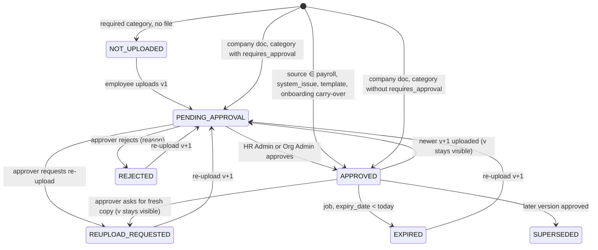
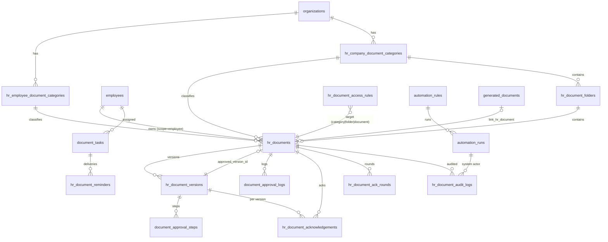
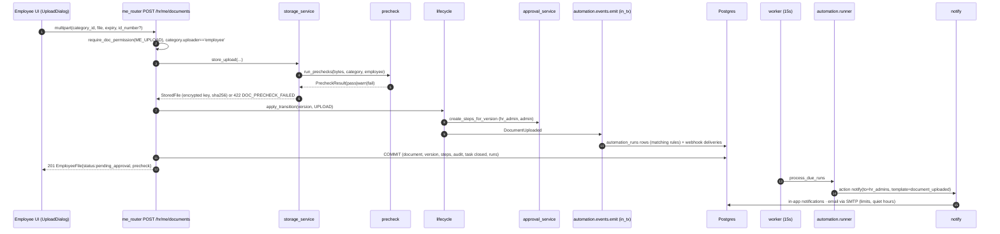
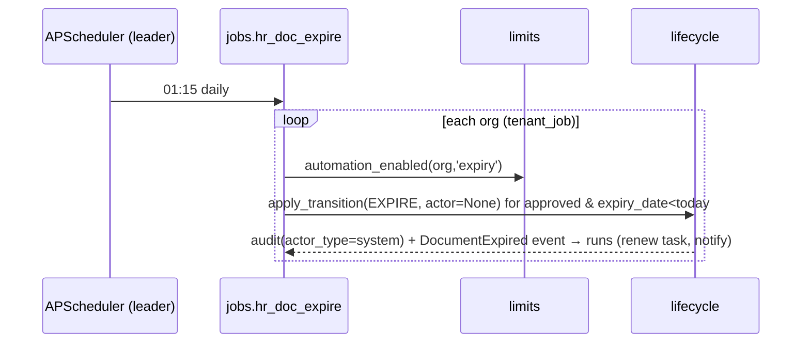

# Zoiko HR: Documents Module Refactor and Automation Layer

**Full architecture and implementation plan (Modules A–E)**

| | |
|---|---|
| Status | Plan, not yet implemented |
| Baseline | `main` @ `f77a7ca` |
| Date | 2026-11-19 |
| Scope | Admin portal (Dashboard, Employee Documents, Company Documents, Approval Workflow); Employee portal (all Documents tabs); Automation layer |
| Follow-up | Company Documents refresh (folders, bulk upload, category settings, email sharing): [ZHR-DOCS-002](ZHR-DOCS-002-company-documents-refresh.md) |
| Stack | FastAPI + SQLAlchemy 2 + Alembic + PostgreSQL. React 19 + Vite, plain JSX, react-router 7, react-query 5, Tailwind 4 |

Legend:
- **[R]** reuse as is
- **[X]** extend an existing file or table
- **[N]** new
- **[D]** delete after the feature flag is removed
- **[→]** redirect only

---

## Contents

**Part I: Analysis**
1. Current state analysis
2. Gap analysis

**Part II: Target design**
3. Target architecture
4. Document lifecycle and state machine
5. RBAC and permission matrix
6. Data model (all tables, both modules)
7. API contract (all endpoints)

**Part III: Code architecture**
8. Backend code architecture
9. Frontend code architecture
10. Key request flows (sequence diagrams)

**Part IV: Automation layer (Module E)**
11. Event catalog
12. Scheduler jobs and escalation
13. Lifecycle, company-document and e-sign automations
14. Upload pre-check pipeline and auto-approval policy
15. Rules engine
16. Reliability

**Part V: Delivery**
17. Screen-by-screen UI spec
18. Migration and rollout
19. Testing strategy
20. Combined phased roadmap
21. Risks, assumptions and open questions

---

# Part I: Analysis

## 1. Current state analysis

### 1.1 Stack detection

| Concern | Today | Evidence |
|---|---|---|
| FE framework | React 19 + Vite 8. **Plain JS/JSX**: one stray `.tsx`, no tsconfig | `frontend/package.json`, `modules/super-admin/AccessReasonSelect.tsx` |
| Router | react-router-dom 7. Flat `routeOverrides` map in `PortalApp.jsx`, `lazyRoute()` | `frontend/src/routes/PortalApp.jsx:242-478`, `lib/lazyRoute.js` |
| HTTP client | `service/api.js`: bearer from `localStorage.zoiko_access_token`, silent refresh on 401, 20 s timeout, errors carry `.status/.code/.detail` | `service/api.js:11,66-158` |
| Data fetching | `@tanstack/react-query` 5. Client in `lib/queryClient.js` (staleTime 30 s, retry once except on 4xx), keys in `service/queryKeys.js`. **No documents page uses it** | `queryKeys.js:48-55` |
| State | Local `useState`; `AuthContext`, `DarkModeContext` | `context/` |
| UI kit | Tailwind 4 + lucide-react. In-house kit in `modules/zoiko-hr/recruitment/ui.jsx`: `ModuleLayout`, `ChipTabs`, `SegmentTabs`, `UnderlineTabs`, `KpiCard`, `Table`, `Pagination`, `EmptyState`, `DetailPanel`, `SearchInput`, `FilterSelect` | `recruitment/ui.jsx:48-104, 323-363` |
| Forms/validation | No library; hand-written checks | `package.json` |
| FE tests | `node --test` + Testing Library + jsdom; puppeteer available | `frontend/__tests__/` |
| Backend | FastAPI 0.111, SQLAlchemy 2, Alembic, PostgreSQL (psycopg), Pydantic 2 | `backend/requirements.txt` |
| Auth | JWT (python-jose). `get_current_user`, `get_current_admin` (admin/hr_admin/super_admin), `get_current_org_admin` | `core/dependencies.py:139,229,241` |
| Tenancy | Explicit `organization_id` filters + ORM auto-scoping + Postgres RLS | `core/privacy/tenant_scope.py`, `core/privacy/rls.py` |
| Entitlements | `require_entitlement(key)` + route→feature map | `core/entitlements.py:44`, `billing/route_entitlement_map.py:187-419` |
| Storage (uploads) | Local disk `<UPLOAD_BASE_DIR>/hr_documents/t<org>/uuid.ext`, **unencrypted** | `hr/router.py:2826`, `core/privacy/files.py:25` |
| Storage (generated) | `DocumentStore` protocol (`LocalDocumentStore`), Fernet for C3/C4 | `doc_templates/storage.py`, `core/crypto.py` |
| Signed URLs | HMAC tokens, ≤300 s, bound to one object and org | `core/privacy/files.py:62-80`, `GET /hr/files/signed/{token}` |
| Scheduler | APScheduler `BackgroundScheduler`; Postgres advisory-lock leader election; `HR_BACKGROUND_JOBS=on/off` | `billing/scheduler.py:165-246`, `core/leader.py` |
| Event bus | `emit_event()` → `hub_webhook_deliveries` + `workflow_executions` rows (DB outbox, after commit) | `integrations/events.py:12-77` |
| Worker | 15 s APScheduler tick: webhook deliveries (5 attempts, backoff 30/120/600/3600 s) + workflow executions | `integrations/worker.py`, `delivery.py`, `engine.py` |
| Background safety | `tenant_job`, `recheck`, `run_in_thread` ("There is no Celery here") | `core/privacy/jobs.py` |
| Email | SMTP, 3 attempts, global send lock with 0.5 s gap; Jinja templates + `_layouts/` | `services/email_service.py:291-500`, `app/email_templates/` |
| In-app notifications | `notify_employee` + `EVENTS`; `notify_org_admins`, `notify_users` | `hr/hr_notifications.py:27-59`, `super_admin/admin_notifications.py:24-63` |
| Preferences | `Employee.notification_preferences {email, sms, push}` | `employee/models.py:171` |
| BE tests | pytest; in-memory SQLite + `TestClient` + `dependency_overrides`; two-tenant `World` fixture | `tests/test_hr_document_*.py`, `tests/doc_templates/conftest.py` |

### 1.2 Two document systems already exist

| | System A: legacy uploaded documents | System B: template engine (`doc_templates`) |
|---|---|---|
| Tables | `hr_documents`, `hr_document_versions`, `hr_document_folders`, `document_approval_steps`, `document_approval_logs`, `document_assignments` (`hr/models.py` ≈2130-2300) | `generated_documents`, `generated_document_approvals`, `document_signatures`, `document_acknowledgements`, `document_events`, `policy_distributions`, `document_expiry_items` (`doc_templates/models.py:297-559`) |
| Covers | Uploaded files, approval chain, folders, assignment | Offers/contracts/policies generated from templates, OTP e-sign, acknowledgement, policy distribution, expiry |
| Routes | `/hr/documents/*`, `/hr/document-folders/*` (`hr/router.py:2832-3459`) | `/hr/generated-documents/*`, `/hr/me/generated-documents/*`, `/hr/policy-distributions`, `/hr/me/policies`, `/hr/me/document-actions` |
| Link | — | `generated_documents.hr_document_id` via `link_hr_document` (`doc_templates/service.py:426`) |

**Decision.** Keep both systems:
- System A, extended, owns uploaded employee and company files.
- System B keeps e-sign, policies and generated documents.
- The portals combine them at the API and view layer. The e-sign stack is not rebuilt.

### 1.3 Admin pages today

Role strings: Org Admin = `admin`, HR Admin = `hr_admin`.

| Screen | Route → component | Data | Notes |
|---|---|---|---|
| Dashboard | `/zoiko-hr/documents` → `modules/zoiko-hr/documents/dashboard.jsx` (also `/hr-admin/documents`) | `GET /hr/documents` (**unpaged**) + `/dashboard/stats` | Stats computed client-side from the full list |
| Employee Documents | `/zoiko-hr/documents/employee-upload` → `modules/organization-admin/EmployeeDocumentsPage.jsx` | `GET /hr/documents?category=&employee_id_str=` | Tabs: Payslips / Offer & Contracts / Tax / All |
| Company Documents | `/zoiko-hr/documents/company-documents` → `company-documents.jsx` | `GET /hr/documents?category=company`, folders, assign | Folder-only structure |
| Approval Workflow | `/zoiko-hr/documents/approvals` → `approvals.jsx` | `GET /hr/documents` + `/approvals/pending`, approve/reject, audit-log | Tabs: Pending / All / Audit |

- **Guards:** `ProtectedRoute allowedRoles={getAllowedRolesForPath(path)}` (`PortalApp.jsx:504-516`). No `PlanGate`.
- **Nav:** `navigation.js:167-172`, plus a duplicate `DOCUMENTS_NAV` in `documents/ui.jsx:4-9`.

### 1.4 Employee pages today

The pages live in `frontend/src/pages/Peoples/Employees/Documents/`. The tab list is `EMPLOYEE_DOCUMENTS_NAV` (`modules/zoiko-hr/documents/ui.jsx:20-29`).

| Tab | Component | Data |
|---|---|---|
| Company Documents | `Employee_CompanyDocuments.jsx` | (a) `IssuedDocumentsSection`: `/hr/me/generated-documents` (System B). (b) `/hr/documents/assigned-to-me` (System A) |
| Documents to Action | `Employee_DocumentsToAction.jsx` | `/hr/me/document-actions` (`doc_templates/golive.py:43-56`) |
| Company Policies | `Employee_CompanyPolicies.jsx` | `/hr/me/policies` |
| Awaiting My Signature | `modules/zoiko-hr/ess/SignatoryQueuePage.jsx` | `/hr/me/generated-documents/signatory-queue`. This is the **employer** signatory queue |
| My Files | `Employee_MyFiles.jsx` | `/hr/documents?category=employee`. **No upload** |
| Payslips | `Employee_Payslips.jsx` | `/hr/documents?category=payslip` (no payroll backend) |
| Offer & Contracts | `Employee_OfferContracts.jsx` | Keyword subset of `category=employee` |
| Tax & Compliance | `Employee_TaxCompliance.jsx` | `/hr/documents?category=tax` |

The old ESS page `modules/zoiko-hr/ess/my-documents.jsx` has the only employee upload form (`:83-207`). The backend refuses it.

### 1.5 Backend inventory

**Legacy endpoints** (`hr/router.py`):

| Line | Method and path | Notes |
|---|---|---|
| 2832 | `GET /hr/documents` | |
| 2874 | `POST /hr/documents/upload` | `_require_document_uploader` = admin/hr_admin/super_admin only, `:145` |
| 2950 | `GET /hr/documents/assigned-to-me` | |
| 2965 | `GET /hr/documents/{id}` | |
| 2981 | `GET /hr/documents/{id}/file` | |
| 3017 | `POST /hr/documents/{id}/download-link` | |
| 3050 | `PUT /hr/documents/{id}` | **any user** |
| 3066 | `PATCH /hr/documents/{id}/status` | **bypasses chain** |
| 3098 | `DELETE /hr/documents/{id}` | |
| 3116 | `GET /hr/documents/dashboard/stats` | |
| 3133-3199 | versions | |
| 3239 | `GET /hr/documents/approvals/pending` | |
| 3251, 3285 | approve, reject | |
| 3314 | `GET /hr/documents/approvals/audit-log` | **any user** |
| 3331-3365 | assign | |
| 3383-3459 | folders | |

**Approval chain** (`hr/service.py`):
- `_DEFAULT_APPROVAL_CHAIN = ["hr_admin","admin"]`.
- `create_default_approval_steps` **auto-approves any uploader with power ≥ 2**, with no `approved_by`.
- `approve_document` marks covered steps APPROVED and higher steps SKIPPED, so either approver completes the document.
- `reject_document` closes the chain.
- No self-approval check (unlike `doc_templates/approvals.py:113 sod_check`).

**Models:**
- `hr_documents.status`: native enum `pending|approved|rejected|expired`.
- `category`: native enum `company|employee|policy|contract|payslip|tax|other`.
- Versions, steps, logs and assignments have no `organization_id`.

**Jobs** (`doc_templates/jobs.py:214-229`): reminders, expiry, expiry_collect (reads `hr_documents.expiry_date`), expiry_digest, retention (flag only), commencement, learning_expiry, new_joiners. **Nothing expires legacy rows.**

**Lifecycle hooks:**
- `user.created` is emitted (`employee/service.py:1240,1808`).
- Role change is only audited (`employee/router.py:772-776`).
- Exit exists twice (`employee/service.py:3692`, `hr/service.py:5785`) and emits nothing.
- `start_onboarding` is at `hr/onboarding_flow.py:367`; `on_onboarding_completed` at `hr/onboarding_documents.py:600`.

**Other:**
- Alembic single head is `c6d7e8f9a0b4_unescape_recruitment_text.py`. Legacy document tables come from the baseline `17aefc359dab`.
- Payroll does not exist (`SCOPE.md:30`).

### 1.6 Problems checked in code

| # | Problem | Where | Root cause |
|---|---|---|---|
| P1 | Admin "Upload Document" on Employee Documents | `EmployeeDocumentsPage.jsx:202-205`, modal `356-460`, "Upload New Version" `514-517` | Page built as an admin upload console |
| P2 | Company Documents empty, no categories | `company-documents.jsx:91, 318-348, 383-388` | No category model |
| P3 | "Search by Employee ID" on Company Documents (no debounce) | `company-documents.jsx:357-362, 92, 119` | Copy-paste |
| P4 | "Expired" button | `company-documents.jsx:30, 363-370, 21-29` | |
| P5 | "Pending (0)" next to "Loading approvals…" | `approvals.jsx:153,237,284-293,324` | Label from a list that starts as `[]`; unpaged `GET /hr/documents` in `Promise.all`; overlapping requests with no sequence guard |
| P6 | Employee-ID search never filters | `approvals.jsx:80-98` `useCallback(…, [])` | Stale closure |
| P7 | Stat cards vs Pending tab mismatch | `approvals.jsx:148-153` | Two sources |
| P8 | Load error falls through to "No documents found" | `approvals.jsx:93-94` | No error state |
| P9 | Row spinner never shows | `approvals.jsx:120,344,433-438` | Document id vs step id |
| P10 | Two loaders on employee Company Documents | `IssuedDocumentsSection.jsx:216-218` + `Employee_CompanyDocuments.jsx:149-152` | Two backends stacked |
| P11 | Two Refresh buttons | `IssuedDocumentsSection.jsx:188-194` + `Employee_CompanyDocuments.jsx:138-144` | Same |
| P12 | Title duplicates tab label (three times) | `recruitment/ui.jsx:71,79,85-98`; `documents/ui.jsx:31-40` | |
| P13 | Overlapping employee tabs | `golive.py:43-49`, `doc_templates/router.py:890-909`, `Employee_OfferContracts.jsx:43-59` | No ownership |
| P14 | Employees cannot upload | `hr/router.py:145-152`, `Employee_MyFiles.jsx:118` | ZHR-46 |
| P15 | Approval chain unreachable | `hr/service.py:6768` + P14 | |
| P16 | Manager can open admin documents pages | `config/roles.js:155, 227-238` | |
| P17 | Admin/HR see 8 employee tabs; 4 redirect | `roles.js:87-91,133-136` | |
| P18 | `PUT /hr/documents/{id}` lets any user change owner/category | `hr/router.py:3050`, `schemas.py:4851` | |
| P19 | `PATCH /status` bypasses chain and audit | `hr/router.py:3066` | |
| P20 | Audit log readable by any user | `hr/router.py:3314` | |
| P21 | Assignment org checks only when `uploaded_by is None` | `hr/service.py:7109,7206` | |
| P22 | Breadcrumb unscoped; folder rename not gated | `hr/service.py:7326`, `hr/router.py:3431` | |
| P23 | Employee never notified of decisions; assignment email unused | `hr/router.py:3272,3301`; `email_service.py:2031` | |
| P24 | Payslip fake ₹0 cards; hard-coded Form 16 notice | `Employee_Payslips.jsx:19,102-104`; `Employee_TaxCompliance.jsx:92-95` | |
| P25 | Unencrypted uploads; `octet-stream`/`zip` MIME accepted; no scan | `hr/router.py:123-161` | |
| P26 | Hard-coded role strings; duplicate `ROLE_LABELS` | `company-documents.jsx:39`, `approvals.jsx:49` | |
| P27 | Entitlement map misses reject/status/file/pending/audit/assigned | `route_entitlement_map.py:187-203` | |
| P28 | Exit logic duplicated in two services; no lifecycle events | `employee/service.py:3692`, `hr/service.py:5785` | |
| P29 | Aadhaar format check has no Verhoeff checksum | `core/identity_formats.py:32-41` | |

### 1.7 Reusable assets

| Asset | Path | Verdict |
|---|---|---|
| `ModuleLayout` (gradient banner, breadcrumb, NavLink tabs) | `modules/zoiko-hr/recruitment/ui.jsx:48-104` | **[X]** count badges, title de-dup |
| `OrganizationDocumentsLayout`, `EmployeeDocumentsLayout` | `modules/zoiko-hr/documents/ui.jsx:42,57` | **[X]** |
| `ChipTabs`, `SegmentTabs`, `UnderlineTabs`, `KpiCard`, `KpiGrid`, `Table`, `Pagination`, `SearchInput`, `FilterSelect`, `EmptyState`, `DetailPanel`, `PrimaryButton` | `recruitment/ui.jsx` | **[R]** |
| `DocumentEmptyState`, `DocumentErrorState`, `DocumentActionDialog`, `SigningSteps`, `SignaturePad`, `SandboxedHtmlPreview` | `components/documents/` | **[R]** |
| `DocumentPreviewModal`, `useDocumentFile` | `components/`, `hooks/` | **[X]** adapters |
| `TableSkeleton`, `CardGridSkeleton` | `components/LoadingSkeletons.jsx` | **[R]** |
| `useToast`, `EntitlementDenied`, `PlanGate` | `hooks/use-toast.jsx`, `components/` | **[R]** |
| `queryClient`, `keys` | `lib/queryClient.js`, `service/queryKeys.js` | **[X]** |
| `sign_download` / `verify_download`, `tenant_upload_path`, `resolve_stored_file` | `core/privacy/files.py`, `hr/file_storage.py` | **[R]** |
| `DocumentStore`, `fernet_for` | `doc_templates/storage.py`, `core/crypto.py` | **[R]** |
| `paginate` / `Page` | `core/pagination.py` | **[R]** `{items,total,page,per_page}` |
| `emit_event`, `EVENT_CATALOG` | `integrations/events.py` | **[X]** |
| `engine.render`, step validation, `resume_at` model | `integrations/engine.py` | **[R]** |
| `delivery.py` retry/backoff | `integrations/delivery.py:22-145` | **[R]** pattern |
| Worker tick | `integrations/worker.py` | **[X]** |
| `tenant_job`, `recheck` | `core/privacy/jobs.py` | **[R]** |
| `_run` job wrapper + `register()` | `doc_templates/jobs.py` | **[X]** |
| `hooks.on/dispatch/subscribe/send` | `doc_templates/hooks.py:38-99` | **[R]** |
| Per-template automation modes, `may_auto_issue` | `doc_templates/automation.py` | **[R]** |
| Policy audiences, material/minor change, new joiners | `doc_templates/distribution.py`, `hr/policy_documents.py` | **[R]** |
| `link_hr_document` | `doc_templates/service.py:426` | **[X]** |
| `notify_employee`, `notify_org_admins`, `notify_users` | see 1.1 | **[X]** |
| `render_email`, SMTP sender | `services/email_service.py` | **[X]** template override |
| Idempotency-Key pattern | `billing/idempotency.py` | **[X]** generalise |
| `PlatformSetting` | `super_admin/models.py:30` | **[R]** global pause |
| Identity validators | `core/identity_formats.py` | **[X]** Verhoeff, masks |
| pypdf, Pillow, pytesseract (installed, unused) | requirements | **[R]** |

---

## 2. Gap analysis

| Area | Current | Target | Change | Risk |
|---|---|---|---|---|
| Who uploads | admin/hr_admin only | Employees upload their own; admins upload company docs only | Split upload gate by `scope`; `POST /hr/me/documents` | **High** (reverses ZHR-46) |
| Approval chain | Unreachable | Every employee upload goes HR Admin → Org Admin; either completes it; SoD; lock | `approval_service` | Med |
| Admin Employee Docs | Upload console | Read-only 3-level drill-down | New pages + endpoints | Low |
| Company Docs | Folders, empty state | Category cards, access control, versions, acknowledgements | New tables + resolver | **High** (leak risk) |
| Approval UI | P5–P9 | Single decision hub, paged, bulk, lock, pre-check badges | Rewrite on react-query | Med |
| Employee tabs | 8 overlapping tabs, double loaders | 7 + 1 conditional, badges | Re-scope + counts | Med |
| Access model | Per-employee assignment only | Rule engine (all/department/role/employees/admin-only) | `hr_document_access_rules` | High |
| Expiry | Legacy rows never expire | Daily expire + 30/15/7 alerts | Jobs | Low |
| Audit | Approval logs only, readable by anyone | Full audit, admin-only, CSV, system actor | `hr_document_audit_logs` | Med |
| Notifications | Admins only, in-app | Employee notified in-app and by email; ladders; digests | Events + tasks + templates | Low |
| Storage security | Unencrypted, bearer-streamed | Encrypted, signed links, scan hook, pre-checks | Storage service + backfill | **High** |
| RBAC | Manager leak, inline strings | One permission map on BE and FE | `permissions.py` / `permissions.js` | Med |
| Automation | Doc-template jobs only | Event-driven rules, tasks, SLAs, lifecycle, retention | Module E | Med |
| Payslips | Empty category | System-issued, auto-approved | Issue endpoint | Q1 |

---

# Part II: Target design

## 3. Target architecture

### 3.1 System diagram

```mermaid
flowchart LR
  subgraph FE[React SPA]
    AP[Admin portal<br/>/zoiko-hr/documents/*]
    EP[Employee portal<br/>/employee/documents/*]
    AU[Automation settings<br/>/zoiko-hr/documents/settings/automation]
    DQ[documents query layer<br/>react-query · keys.documents · keys.automation]
    AP & EP & AU --> DQ
  end
  DQ -->|Bearer JWT| API

  subgraph API[FastAPI /hr  — mounted before hr_router]
    R1[documents/admin_router.py]
    R2[documents/approval_router.py]
    R3[documents/me_router.py]
    R4[documents/files_router.py]
    R5[documents/automation/router.py]
    DEP[Depends: get_current_user · require_doc_permission · require_entitlement · request_ctx]
  end

  subgraph SVC[Domain services  app/modules/hr/documents]
    PS[permissions] --- AR[access_resolver]
    LS[lifecycle] --- APS[approval_service]
    CS[completion_service] --- ES[employee_docs_service]
    CO[company_service] --- ME[me_service]
    ST[storage_service + precheck + scan + ocr]
    AUD[audit_service]
    NT[notify]
    TK[automation/tasks]
  end
  API --> SVC

  subgraph BUS[Event bus  integrations]
    EM[emit_event in_tx<br/>EVENT_CATALOG]
    OUT[(hub_webhook_deliveries<br/>workflow_executions<br/>automation_runs)]
    WK[worker tick 15s]
  end
  SVC -->|domain events| EM --> OUT --> WK
  WK --> RUN[automation/runner<br/>rules · actions · retry · DLQ]
  RUN --> SVC

  subgraph JOBS[APScheduler  leader only]
    J[expire · expiry_alerts · task_escalation · approval_sla · ack_reminders<br/>yearly_reack · scheduled_publish · weekly_digest · retention_sweep · offboarding_finalize]
  end
  JOBS --> SVC

  subgraph DB[(PostgreSQL + RLS)]
    A[(hr_documents · versions · folders · steps · logs)]
    B[(categories · access_rules · acknowledgements · audit · reminders)]
    C[(automation_rules · runs · settings · notification_templates · document_tasks · retention_policies)]
    G[(doc_templates: generated_documents · signatures · acks · policy_distributions)]
  end
  SVC --> DB
  ST --> FS[(DocumentStore<br/>t&lt;org&gt;/…enc)]
  NT --> IN[super_admin_notifications]
  NT --> MAIL[email_service SMTP]
  RUN --> HOOK[hub_webhooks · Slack · SMS]
  G <-.->|link_hr_document · hooks.on executed| A
  PAY[Payroll / bulk issue] -.->|POST /hr/documents/system/issue| R4
```

### 3.2 Layering rules (enforced in review and by a test that scans imports)

1. `*_router.py` → `*_service.py` → models. Routers hold no query logic; services never import routers.
2. Only `permissions.py` knows role strings. Every other module asks `has_doc_permission(user, DocAction.X)`.
3. Only `access_resolver.py` decides company-document visibility, and it returns SQL (`Select`) for lists. Python-side filtering of lists is forbidden.
4. Only `lifecycle.apply_transition()` changes a version's status. `approval_service`, jobs and automation actions all call it.
5. Only `storage_service` touches the file system or `DocumentStore`.
6. Domain events go out through `automation.events.emit(db, Event)`, a typed wrapper over `emit_event(in_tx=True)`. They are written inside the business transaction.
7. `automation/*` calls domain services only through `automation/actions.py`. Domain services never import `automation.runner`.
8. `doc_templates` is used only through `service.link_hr_document`, `service.generate`, `hooks.on`, `automation.mode_for` and `distribution.audience_employees`.

## 4. Document lifecycle and state machine

Status is kept **per version** (`hr_document_versions.status`):
- `hr_documents.status` mirrors the latest version.
- `hr_documents.approved_version_id` points at the version readers see.
- `NOT_UPLOADED` is computed (a required category with no file) and never stored.



| Event | From → to | Actor | Guards | Side effects (same transaction) |
|---|---|---|---|---|
| `UPLOAD` | ∅/REJECTED/REUPLOAD_REQUESTED/EXPIRED/APPROVED → PENDING | Employee (own, `scope=employee`); Admin/HR (company + requires_approval) | Pre-check not `fail`; category accepts this uploader; employee active; no other pending version | Version row; steps `[hr_admin, admin]`; audit `uploaded`; event `document.uploaded`; close `upload_required`/`reupload` task |
| `APPROVE` | PENDING → APPROVED | hr_admin or admin | SoD (actor ≠ uploader, actor ≠ subject); holds lock or no lock; `version_id` current | Covered steps APPROVED, higher steps SKIPPED; `approved_version_id`; previous approved → SUPERSEDED; audit; event `document.approved` |
| `REJECT` | PENDING → REJECTED | hr_admin or admin | Same; `reason_code` + note ≥5 characters | Steps closed; `rejection_reason`; audit; event `document.rejected{reupload:false}`; `reupload` task |
| `REQUEST_REUPLOAD` | PENDING/APPROVED → REUPLOAD_REQUESTED | hr_admin or admin | Note required | Audit; event `document.rejected{reupload:true}`; `reupload` task. An APPROVED version stays visible |
| `EXPIRE` | APPROVED → EXPIRED | system | `expiry_date < today` | Audit (system actor); event `document.expired`; `renew` task |
| `SUPERSEDE` | APPROVED → SUPERSEDED | system (inside APPROVE) | — | — |
| `AUTO_APPROVE` | ∅ → APPROVED | system | `auto_approval_reason() is not None` (§14.2) | Audit `auto_approved{reason}`; event `document.approved{auto:true}` |

## 5. RBAC and permission matrix

Role strings come from the code: `admin` (Org Admin), `hr_admin`, `manager`, `employee`, `super_admin`. There is no HR Manager or Finance role today; Finance is a placeholder slot (Q3).

Legend: ✅ allowed · 🔸 own/scoped · ❌ hidden in the UI **and** 403 from the API

| Action (`DocAction`) | Org Admin | HR Admin | Manager | Employee | Finance* |
|---|---|---|---|---|---|
| `emp_docs.view`: list employees, completion, files | ✅ | ✅ | ❌ (Q4) | ❌ | 🔸 payslips/tax |
| `emp_docs.remind` | ✅ | ✅ | ❌ | ❌ | ❌ |
| `emp_docs.export` (ZIP) | ✅ | ✅ | ❌ | ❌ | ❌ |
| `category.manage` (employee and company) | ✅ | ✅ | ❌ | ❌ | ❌ |
| Upload on behalf of an employee | ❌ | ❌ | ❌ | ❌ | ❌ |
| `company.manage` (upload, version, folders, delete) | ✅ | ✅ | ❌ | ❌ | 🔸 payslip templates |
| `company.share` (access rules) | ✅ | ✅ (not Org-Admin-locked categories) | ❌ | ❌ | ❌ |
| `approval.queue` | ✅ | ✅ | ❌ | ❌ | ❌ |
| `approval.decide` (incl. bulk) | ✅ (not self) | ✅ (not self, not own documents) | ❌ | ❌ | ❌ |
| `audit.view` / CSV | ✅ | ✅ | ❌ | ❌ | ❌ |
| `automation.manage` (rules, templates, settings) | ✅ | ✅ (not global settings) | ❌ | ❌ | ❌ |
| `me.upload` / `me.view` (own My Files) | 🔸 | 🔸 | 🔸 | 🔸 | 🔸 |
| Company docs read, download, acknowledge | per rule | per rule | per rule | per rule | per rule |
| `system.issue` (payslips, Form 16) | ❌ | ❌ (Q1) | ❌ | ❌ | ✅ / service token |
| Signatory queue | if designated signatory | same | same | same | same |
| super_admin | ❌ all data-plane routes (`get_current_user`) | | | | |

**Enforcement**
- **Backend:** `require_doc_permission(action)` dependency on every route, plus query-level scoping (`employee_scope_filter`, `access_resolver.visible_company_docs_query`), plus RLS.
- **Frontend:** `permissions.js` mirrors `DOC_PERMISSIONS`. A CI parity test compares it with JSON exported from the backend.
- **roles.js:**
  - Add `/zoiko-hr/documents` to `ROLE_DISALLOWED_PREFIXES[MANAGER]` (P16).
  - Allow `/employee/documents` for `admin` and `hr_admin` (P17).
  - Wrap approval and automation routes in `PlanGate featureKey="hr.documents.workflow"`.

## 6. Data model

### 6.1 Table map

Where possible, the tables you asked for map onto existing tables, so FKs from versions, steps, assignments and `link_hr_document` don't move. New tables on the uploaded-documents side use an `hr_` prefix, because `document_signatures` and `document_acknowledgements` already exist in `doc_templates`, are append-only, and have a NOT NULL FK to `generated_documents`.

| Logical name | Physical table | Status |
|---|---|---|
| employee_document_categories | `hr_employee_document_categories` | [N] |
| company_document_categories | `hr_company_document_categories` | [N] |
| employee_documents / company_documents | `hr_documents` with `scope = employee \| company` | [X] |
| document_versions | `hr_document_versions` | [X] |
| document_access_rules | `hr_document_access_rules` | [N] |
| document_acknowledgements | `hr_document_acknowledgements` (uploaded docs); `document_acknowledgements` (generated) | [N] / [R] |
| document_signatures | `document_signatures` (doc_templates) | [R] |
| document_approvals | `document_approval_steps` + `document_approval_logs` | [X] |
| document_audit_logs | `hr_document_audit_logs` | [N] |
| document_reminders | `hr_document_reminders` (delivery log) | [N] |
| ack rounds (yearly re-ack) | `hr_document_ack_rounds` | [N] |
| automation_rules / automation_runs | `automation_rules`, `automation_runs` | [N] |
| automation settings | `automation_settings` | [N] |
| notification_templates | `notification_templates` | [N] |
| document_tasks | `document_tasks` | [N] |
| retention_policies | `retention_policies` | [N] |
| folders | `hr_document_folders` (+ `category_id`) | [X] |
| assignments (legacy) | `document_assignments`: frozen after migration, dropped later | [D] |

### 6.2 Entity relationships



### 6.3 DDL: documents core

```sql
-- [N] Employee containers
CREATE TABLE hr_employee_document_categories (
  id                      serial PRIMARY KEY,
  organization_id         int NOT NULL REFERENCES organizations(id),
  key                     varchar(50) NOT NULL,   -- identity_proof | address_proof | education | previous_employment |
                                                  -- offer_contracts | payslips | tax_compliance | bank_details | medical_other | custom_*
  name                    varchar(120) NOT NULL,
  description             text,
  is_required             boolean NOT NULL DEFAULT false,
  uploader                varchar(20) NOT NULL DEFAULT 'employee',   -- employee | company | system
  requires_expiry         boolean NOT NULL DEFAULT false,
  max_files               int,
  sensitivity             varchar(4) NOT NULL DEFAULT 'C3',          -- privacy classes C1..C4
  applies_to              jsonb,                                     -- {department_ids:[], employment_types:[]}
  id_number_field         varchar(20),                               -- aadhaar | pan | passport | null  (pre-check 5)
  human_approval_required boolean NOT NULL DEFAULT false,            -- TRUE + immutable for identity/address/education
  escalation_ladder       jsonb,                                     -- §12.2; null = org default
  sort_order              int NOT NULL DEFAULT 0,
  is_system               boolean NOT NULL DEFAULT false,
  is_active               boolean NOT NULL DEFAULT true,
  created_by              int REFERENCES employees(id),
  created_at              timestamp NOT NULL DEFAULT now(),
  updated_at              timestamp NOT NULL DEFAULT now(),
  UNIQUE (organization_id, key)
);
CREATE INDEX ix_hedc_org_active ON hr_employee_document_categories (organization_id, is_active, sort_order);

-- [N] Company categories
CREATE TABLE hr_company_document_categories (
  id                       serial PRIMARY KEY,
  organization_id          int NOT NULL REFERENCES organizations(id),
  key                      varchar(50) NOT NULL,  -- company_policies | employee_handbook | onboarding | payslip_templates |
                                                  -- forms_templates | compliance_legal | holiday_announcements | training | custom_*
  name                     varchar(120) NOT NULL,
  icon                     varchar(40),
  requires_approval        boolean NOT NULL DEFAULT false,
  default_require_ack      boolean NOT NULL DEFAULT false,
  ack_reminder_after_days  int,
  reack_interval_months    int,                   -- yearly re-ack = 12
  auto_unpublish_on_expiry boolean NOT NULL DEFAULT false,
  locked_by_org_admin      boolean NOT NULL DEFAULT false,   -- HR Admin cannot widen access (Q5)
  escalation_ladder        jsonb,
  is_system                boolean NOT NULL DEFAULT false,
  is_active                boolean NOT NULL DEFAULT true,
  sort_order               int NOT NULL DEFAULT 0,
  created_by               int REFERENCES employees(id),
  created_at               timestamp NOT NULL DEFAULT now(),
  updated_at               timestamp NOT NULL DEFAULT now(),
  UNIQUE (organization_id, key)
);

-- [X] hr_documents
ALTER TABLE hr_documents
  ADD COLUMN scope                varchar(10) NOT NULL DEFAULT 'employee',   -- employee | company
  ADD COLUMN employee_category_id int REFERENCES hr_employee_document_categories(id),
  ADD COLUMN company_category_id  int REFERENCES hr_company_document_categories(id),
  ADD COLUMN source               varchar(20) NOT NULL DEFAULT 'employee',   -- employee|company|payroll|system_issue|template|onboarding|legacy_admin
  ADD COLUMN approved_version_id  int REFERENCES hr_document_versions(id),
  ADD COLUMN reason_code          varchar(40),
  ADD COLUMN storage_key          varchar(500),
  ADD COLUMN is_encrypted         boolean NOT NULL DEFAULT false,
  ADD COLUMN sha256               varchar(64),
  ADD COLUMN review_locked_by     int REFERENCES employees(id),
  ADD COLUMN review_locked_until  timestamp,
  ADD COLUMN publish_state        varchar(12) NOT NULL DEFAULT 'published',  -- draft|scheduled|published|unpublished
  ADD COLUMN publish_at           timestamp,
  ADD COLUMN is_archived          boolean NOT NULL DEFAULT false,
  ADD COLUMN retention_until      date,
  ADD COLUMN legal_hold           boolean NOT NULL DEFAULT false,
  ADD CONSTRAINT ck_hd_scope_cat CHECK (
    (scope='employee' AND company_category_id IS NULL) OR (scope='company' AND employee_category_id IS NULL));
-- ALTER TYPE hrdocumentstatus ADD VALUE 'reupload_requested';   -- in autocommit_block
CREATE INDEX ix_hd_emp_cat ON hr_documents (organization_id, employee_id, employee_category_id) WHERE scope='employee' AND NOT is_deleted;
CREATE INDEX ix_hd_comp    ON hr_documents (organization_id, company_category_id, folder_id)   WHERE scope='company'  AND NOT is_deleted;
CREATE INDEX ix_hd_status  ON hr_documents (organization_id, status, created_at)              WHERE NOT is_deleted;
CREATE INDEX ix_hd_expiry  ON hr_documents (organization_id, expiry_date)                     WHERE expiry_date IS NOT NULL AND NOT is_deleted;
CREATE INDEX ix_hd_publish ON hr_documents (publish_state, publish_at)                        WHERE publish_state='scheduled';
-- `category` (legacy enum) and `access_control` (JSON): read-only for one release, dropped in D5.

-- [X] hr_document_versions
ALTER TABLE hr_document_versions
  ADD COLUMN organization_id  int REFERENCES organizations(id),   -- backfilled → NOT NULL in D5
  ADD COLUMN status           varchar(20) NOT NULL DEFAULT 'approved',
                              -- pending_approval|approved|rejected|reupload_requested|expired|superseded
  ADD COLUMN expiry_date      date,
  ADD COLUMN rejection_reason text,
  ADD COLUMN reason_code      varchar(40),
  ADD COLUMN decided_by       int REFERENCES employees(id),
  ADD COLUMN decided_role     varchar(20),
  ADD COLUMN decided_at       timestamp,
  ADD COLUMN storage_key      varchar(500),
  ADD COLUMN is_encrypted     boolean NOT NULL DEFAULT false,
  ADD COLUMN sha256           varchar(64),
  ADD COLUMN scan_status      varchar(12) NOT NULL DEFAULT 'skipped',   -- pending|clean|infected|skipped
  ADD COLUMN precheck         jsonb,                                    -- §14.1
  ADD COLUMN material_change  boolean NOT NULL DEFAULT true,            -- company docs: resets acks
  ADD CONSTRAINT uq_hdv_doc_version UNIQUE (document_id, version);
CREATE INDEX ix_hdv_org_status ON hr_document_versions (organization_id, status);
CREATE INDEX ix_hdv_org_sha    ON hr_document_versions (organization_id, sha256);   -- duplicate detection

-- [X] approval steps / logs
ALTER TABLE document_approval_steps ADD COLUMN organization_id int, ADD COLUMN version_id int REFERENCES hr_document_versions(id),
  ADD COLUMN sla_level int NOT NULL DEFAULT 0;
CREATE INDEX ix_das_queue ON document_approval_steps (organization_id, status, required_role, created_at);
ALTER TABLE document_approval_logs ADD COLUMN organization_id int, ADD COLUMN version_id int, ADD COLUMN reason_code varchar(40);
-- action vocabulary: approved|rejected|skipped|version_uploaded|reupload_requested|auto_approved

-- [X] folders
ALTER TABLE hr_document_folders ADD COLUMN company_category_id int REFERENCES hr_company_document_categories(id);

-- [N] access rules (one per target; union inside arrays)
CREATE TABLE hr_document_access_rules (
  id               serial PRIMARY KEY,
  organization_id  int NOT NULL REFERENCES organizations(id),
  target_type      varchar(10) NOT NULL,     -- category | folder | document
  target_id        int NOT NULL,
  inherit          boolean NOT NULL DEFAULT true,
  visibility       varchar(20) NOT NULL,     -- admin_only | all_employees | departments | roles | employees
  department_ids   int[],
  roles            varchar(20)[],
  employee_ids     int[],
  permission       varchar(10) NOT NULL DEFAULT 'view',   -- view | download
  require_ack      boolean NOT NULL DEFAULT false,
  updated_by       int REFERENCES employees(id),
  updated_at       timestamp NOT NULL DEFAULT now(),
  UNIQUE (organization_id, target_type, target_id)
);
CREATE INDEX ix_hdar_dept ON hr_document_access_rules USING gin (department_ids);
CREATE INDEX ix_hdar_emps ON hr_document_access_rules USING gin (employee_ids);

-- [N] acknowledgements of uploaded company docs (append-only)
CREATE TABLE hr_document_acknowledgements (
  id               serial PRIMARY KEY,
  organization_id  int NOT NULL,
  document_id      int NOT NULL REFERENCES hr_documents(id),
  version_id       int NOT NULL REFERENCES hr_document_versions(id),
  round_no         int NOT NULL DEFAULT 1,
  employee_id      int NOT NULL REFERENCES employees(id),
  acknowledged_at  timestamp NOT NULL,
  ip_address       varchar(45),
  user_agent       varchar(400),
  document_sha256  varchar(64) NOT NULL,
  UNIQUE (version_id, round_no, employee_id)
);
CREATE INDEX ix_hda_doc ON hr_document_acknowledgements (organization_id, document_id);

-- [N] re-acknowledgement rounds
CREATE TABLE hr_document_ack_rounds (
  id serial PRIMARY KEY, organization_id int NOT NULL, document_id int NOT NULL REFERENCES hr_documents(id),
  version_id int NOT NULL, round_no int NOT NULL, reason varchar(20) NOT NULL,  -- initial|new_version|periodic
  opened_at timestamp NOT NULL, due_at timestamp,
  UNIQUE (document_id, round_no)
);

-- [N] audit (append-only, PG trigger like document_events)
CREATE TABLE hr_document_audit_logs (
  id                bigserial PRIMARY KEY,
  organization_id   int NOT NULL,
  actor_type        varchar(12) NOT NULL DEFAULT 'user',  -- user | system | automation
  actor_id          int REFERENCES employees(id),
  actor_role        varchar(20),
  automation_run_id bigint, rule_id int,
  action            varchar(30) NOT NULL,  -- uploaded|version_uploaded|viewed|downloaded|exported|approved|rejected|
                                           -- reupload_requested|auto_approved|expired|access_changed|acknowledged|
                                           -- reminder_sent|deleted|category_changed|lock_acquired|published|unpublished|archived
  target_type       varchar(15) NOT NULL,  -- document|version|category|folder|access_rule|employee|rule
  target_id         int NOT NULL,
  document_id       int, employee_id int,
  ip_address        varchar(45), user_agent varchar(400),
  before            jsonb, after jsonb,    -- masked; never file content
  created_at        timestamp NOT NULL DEFAULT now()
);
CREATE INDEX ix_hdal_org_time ON hr_document_audit_logs (organization_id, created_at DESC);
CREATE INDEX ix_hdal_doc      ON hr_document_audit_logs (organization_id, document_id, created_at DESC);
CREATE INDEX ix_hdal_action   ON hr_document_audit_logs (organization_id, action, created_at DESC);

-- [N] reminder / notification delivery log
CREATE TABLE hr_document_reminders (
  id serial PRIMARY KEY, organization_id int NOT NULL,
  task_id int,                                  -- FK document_tasks (nullable for ad-hoc)
  kind varchar(20) NOT NULL,                    -- upload_missing|reupload|acknowledge|expiry_30|expiry_15|expiry_7|sla|escalation|digest
  level int NOT NULL DEFAULT 0,
  employee_id int, document_id int, employee_category_id int,
  sent_by int REFERENCES employees(id),         -- null = system
  channel varchar(10) NOT NULL,                 -- in_app|email|both|slack|sms
  message text, sent_at timestamp NOT NULL DEFAULT now(), resolved_at timestamp
);
CREATE INDEX ix_hdr_open ON hr_document_reminders (organization_id, employee_id, kind) WHERE resolved_at IS NULL;
CREATE UNIQUE INDEX uq_hdr_expiry ON hr_document_reminders (document_id, kind) WHERE kind LIKE 'expiry_%';
CREATE UNIQUE INDEX uq_hdr_task_level ON hr_document_reminders (task_id, level) WHERE task_id IS NOT NULL;
```

### 6.4 DDL: automation

```sql
CREATE TABLE document_tasks (
  id serial PRIMARY KEY, organization_id int NOT NULL,
  kind varchar(20) NOT NULL,          -- upload_required|reupload|acknowledge|review|sign|renew
  employee_id int,                    -- assignee (employee tasks)
  assignee_role varchar(20),          -- hr_admin|admin for review tasks
  document_id int, version_id int, employee_category_id int, generated_document_id int, ack_round_id int,
  status varchar(12) NOT NULL DEFAULT 'open',      -- open|done|cancelled|overdue
  due_at timestamp, escalation_level int NOT NULL DEFAULT 0, ladder jsonb,
  source varchar(20) NOT NULL,        -- rule|manual|system
  rule_id int, created_by int, created_at timestamp NOT NULL DEFAULT now(),
  closed_at timestamp, close_reason varchar(30)    -- completed|exited|not_required|superseded|cancelled_by_hr
);
CREATE INDEX ix_dt_open ON document_tasks (organization_id, employee_id, status) WHERE status IN ('open','overdue');
CREATE INDEX ix_dt_due  ON document_tasks (status, due_at) WHERE status IN ('open','overdue');
CREATE UNIQUE INDEX uq_dt_open_once ON document_tasks
  (employee_id, kind, coalesce(document_id,0), coalesce(employee_category_id,0), coalesce(ack_round_id,0))
  WHERE status IN ('open','overdue');

CREATE TABLE automation_rules (
  id serial PRIMARY KEY, organization_id int NOT NULL, key varchar(60),   -- 'sys.*' for system rules
  name varchar(120) NOT NULL, description text,
  trigger_event varchar(80), trigger_cron varchar(60),                    -- exactly one (CHECK)
  definition jsonb NOT NULL,                                              -- §15.1
  status varchar(10) NOT NULL DEFAULT 'paused',                           -- active|paused|shadow
  is_system boolean NOT NULL DEFAULT false, version int NOT NULL DEFAULT 1,
  created_by int, updated_by int, created_at timestamp NOT NULL DEFAULT now(), updated_at timestamp,
  UNIQUE (organization_id, key),
  CHECK ((trigger_event IS NULL) <> (trigger_cron IS NULL))
);
CREATE INDEX ix_ar_match ON automation_rules (organization_id, trigger_event) WHERE status <> 'paused';

CREATE TABLE automation_runs (
  id bigserial PRIMARY KEY, organization_id int NOT NULL,
  rule_id int REFERENCES automation_rules(id) ON DELETE SET NULL, rule_version int,
  event_id varchar(64), event_type varchar(80), trigger_payload jsonb,
  definition_snapshot jsonb NOT NULL,
  mode varchar(10) NOT NULL DEFAULT 'live',              -- live|dry_run|shadow
  status varchar(12) NOT NULL DEFAULT 'pending',         -- pending|running|waiting|succeeded|failed|dead|skipped
  skip_reason varchar(40), current_step int NOT NULL DEFAULT 0, step_results jsonb,
  attempt int NOT NULL DEFAULT 0, next_attempt_at timestamp, resume_at timestamp,
  error varchar(500), idempotency_key varchar(64) NOT NULL UNIQUE,
  created_at timestamp NOT NULL DEFAULT now(), started_at timestamp, finished_at timestamp
);
CREATE INDEX ix_arun_due ON automation_runs (status, next_attempt_at);
CREATE INDEX ix_arun_org ON automation_runs (organization_id, created_at DESC);

CREATE TABLE automation_settings (
  organization_id int PRIMARY KEY, paused boolean NOT NULL DEFAULT false,
  features jsonb NOT NULL DEFAULT '{}',     -- onboarding,reminders,expiry,payslip_publish,sla,prechecks,policy_auto,
                                            -- digest,esign_autofile,ocr,offboarding,rules_ui
  quiet_hours jsonb,                        -- {start:"20:00", end:"08:00", tz:"Asia/Kolkata"}
  rate_limits jsonb,                        -- {emails_per_hour:500, reminders_per_employee_per_day:5}
  approval_sla_hours int NOT NULL DEFAULT 72,
  default_ladder jsonb, lock_after_exit_days int NOT NULL DEFAULT 30,
  updated_by int, updated_at timestamp
);

CREATE TABLE notification_templates (       -- org overrides; file templates stay the default
  id serial PRIMARY KEY, organization_id int NOT NULL, key varchar(60) NOT NULL,
  channel varchar(10) NOT NULL,             -- email|in_app|sms
  subject varchar(200), body text NOT NULL, locale varchar(10) NOT NULL DEFAULT 'en',
  is_active boolean NOT NULL DEFAULT true, updated_by int, updated_at timestamp,
  UNIQUE (organization_id, key, channel, locale)
);

CREATE TABLE retention_policies (
  id serial PRIMARY KEY, organization_id int NOT NULL,
  scope varchar(10) NOT NULL, category_key varchar(50) NOT NULL,
  retain_years int NOT NULL, clock varchar(15) NOT NULL,        -- from_upload|from_exit|from_expiry
  action varchar(10) NOT NULL DEFAULT 'archive',                -- flag|archive|delete
  review_days int NOT NULL DEFAULT 30, updated_by int, updated_at timestamp,
  UNIQUE (organization_id, scope, category_key)
);

ALTER TABLE policy_distributions ADD COLUMN publish_at timestamp, ADD COLUMN reack_interval_months int;   -- [X] doc_templates
```

All new tables:
- get Postgres RLS policies on `organization_id` (pattern in `core/privacy/rls.py`)
- are registered in the ORM tenant scope (`core/privacy/tenant_scope.py`)
- are added to the privacy classification (`core/privacy/classification.py`, regenerated doc)

### 6.5 Migrations

Alembic, chained after `c6d7e8f9a0b4`.

| Rev | File | Content | Downgrade |
|---|---|---|---|
| D1 | `e1a2b3c4d5f0_document_categories.py` | Two category tables + idempotent seed per org | drop |
| D2 | `e1a2b3c4d5f1_hr_documents_scope_versions.py` | Columns on documents, versions, steps, logs, folders; enum value via `autocommit_block` | drop columns (enum value is left; harmless) |
| D3 | `e1a2b3c4d5f2_documents_backfill.py` | Data: scope, category ids, `source=legacy_admin`, versions `organization_id`, v1 rows, `approved_version_id` | no-op (originals untouched) |
| D4 | `e1a2b3c4d5f3_access_acks_audit.py` | Access rules, acks, ack rounds, audit, reminders; seed rules from `document_assignments`, otherwise `admin_only` | drop |
| D5 | `e1a2b3c4d5f4_automation_core.py` | `automation_rules`, `automation_runs`, `automation_settings`, `notification_templates`, `document_tasks`, `retention_policies`, `policy_distributions` columns; seed system rules + default retention per org | drop |
| D6 | `e1a2b3c4d5f5_documents_contract.py` (later release) | `organization_id NOT NULL`; RLS; drop `access_control`; freeze `document_assignments` | revert constraints |

**Legacy category mapping (D3):**

| Legacy `category` | Maps to |
|---|---|
| `company` | `company_policies` or `forms_templates` (by `document_type`) |
| `policy` | `company_policies` |
| `employee` | inferred from keywords, otherwise `medical_other`, plus a row in `migration_unmapped_documents` for HR review |
| `contract` | `offer_contracts` |
| `payslip` | `payslips` |
| `tax` | `tax_compliance` |
| `other` | `medical_other` if `employee_id` is set, else `forms_templates` |

**File encryption backfill:**
- Script: `backend/scripts/encrypt_hr_documents.py` [N]. It is idempotent, resumable and batched (500 rows).
- Reads fall back to `file_path` while `storage_key IS NULL`.

## 7. API contract

Conventions (existing):
- Prefix `/hr`.
- Paging `?page=&per_page=` → `{items,total,page,per_page}`; `per_page` ≤ 200 (`core/pagination.py`).
- Errors: `ZoikoException` subclasses → `{"detail", "code"}`.
- Every new route is added to `billing/route_entitlement_map.py`:
  - `hr.documents.core`: employee docs, company docs, me
  - `hr.documents.workflow`: approvals, automation
  - `hr.documents.bulk_distribution`: bulk reminders, bulk issue

**Error codes:**

| Code | HTTP | Meaning |
|---|---|---|
| `DOC_NOT_FOUND` | 404 | Also returned for invisible documents, so existence isn't leaked |
| `DOC_FORBIDDEN` | 403 | |
| `DOC_SELF_APPROVAL` | 409 | |
| `DOC_LOCKED` | 409 | Includes `locked_by_name` and `locked_until` |
| `DOC_ALREADY_DECIDED` | 409 | |
| `DOC_STALE_VERSION` | 409 | |
| `DOC_PENDING_EXISTS` | 409 | |
| `DOC_NO_ELIGIBLE_APPROVER` | 409 | |
| `DOC_INVALID_FILE` | 422 | |
| `DOC_PRECHECK_FAILED` | 422 | Includes `checks[]` |
| `DOC_CATEGORY_CLOSED` | 422 | |
| `DOC_REMINDER_COOLDOWN` | 429 | |
| `AUTOMATION_RULE_INVALID` | 422 | Includes `errors[]` |
| `AUTOMATION_FORBIDDEN_ACTION` | 422 | |
| `AUTOMATION_SYSTEM_RULE` | 409 | |
| `IDEMPOTENCY_CONFLICT` | 409 | |
| `ENTITLEMENT_REQUIRED` | 402 or 403 | |

### 7.1 Admin → Employee Documents

New router: `documents/admin_router.py`. Permission: `emp_docs.*`.

| Method | Path | Request | Response |
|---|---|---|---|
| GET | `/hr/documents/employees` | `search` (name or employee ID), `department_id`, `status` (complete\|pending\|needs_review\|expired), `joined_from`, `joined_to`, `sort`, `page`, `per_page` | `Page<EmployeeDocSummary>` |
| GET | `/hr/documents/employees/{employee_id}` | — | `{employee, summary: CompletionSummary, categories: CategoryContainer[], last_reminder_at}` |
| GET | `/hr/documents/employees/{employee_id}/categories/{category_id}/files` | `include_history` | `{category, files: EmployeeFile[]}` |
| POST | `/hr/documents/employees/{employee_id}/reminders` | `{category_ids[], message?, channel}` | `{sent}`; 429 cooldown (24 h) |
| POST | `/hr/documents/reminders/bulk` | `{employee_ids?[], filter?{department_id,status}, category_ids?[]}` + `Idempotency-Key` | `{queued, skipped}` |
| GET | `/hr/documents/employees/{employee_id}/export.zip` | `approved_only` | streamed zip (≤500 MB) + audit `exported` |
| POST | `/hr/documents/employees/export` | `{employee_ids[≤50]}` | 202 `{run_id}` → notification with a signed link |
| GET / POST | `/hr/documents/employee-categories` | `EmployeeCategoryIn` | `EmployeeCategory[]` / `EmployeeCategory` |
| PATCH / DELETE | `/hr/documents/employee-categories/{id}` | | 409 if `is_system` (DELETE) or has files (deactivated instead) |

### 7.2 Admin → Company Documents

Permission: `company.*`.

| Method | Path | Request | Response |
|---|---|---|---|
| GET | `/hr/documents/company-categories` | `access`, `search` | `CompanyCategoryCard[]` |
| POST / PATCH / DELETE | `/hr/documents/company-categories[/{id}]` | `{name, icon?, requires_approval, default_require_ack, ack_reminder_after_days?, reack_interval_months?, auto_unpublish_on_expiry, locked_by_org_admin?}` | `CompanyCategory` |
| GET | `/hr/documents/company-categories/{id}/items` | `folder_id`, `expiry` (all\|expiring_soon\|expired), `search`, `page` | `{breadcrumb, folders[], files: Page<CompanyFile>}` |
| GET | `/hr/documents/company/files` | `expiry`, `access`, `search`, `page` | Flat list across categories (segment view) |
| POST | `/hr/documents/company-categories/{id}/files` | multipart `file, title, description?, folder_id?, expiry_date?, require_ack?, notify?, publish_at?` | 201 `CompanyFile` |
| POST | `/hr/documents/{document_id}/versions` [X] | multipart `file, change_notes?, expiry_date?, material_change?` | 201 `DocumentVersion` |
| GET | `/hr/documents/{document_id}/versions` [X] | — | `DocumentVersion[]` |
| POST | `/hr/documents/{document_id}/publish` | `{publish_at?: datetime}` (null = now) | `CompanyFile` |
| POST | `/hr/documents/{document_id}/unpublish` | — | `CompanyFile` |
| `/hr/document-folders/*` [X] | | + `company_category_id`; rename admin-gated; breadcrumb org-scoped | |
| GET / PUT | `/hr/documents/access/{target_type}/{target_id}` | `AccessRuleIn` | `AccessRule & {effective, inherited_from?}` |
| POST | `/hr/documents/access/preview` | `AccessRuleIn` | `{audience_count, sample: EmployeeLite[≤10]}` |
| GET | `/hr/documents/{document_id}/acknowledgements` | `status`, `round_no?`, `page` | `Page<AckRow> & {acknowledged, pending, total}` |
| POST | `/hr/documents/{document_id}/acknowledgements/remind` | `{employee_ids?[]}` | `{sent}` |

### 7.3 Approval Workflow

New router: `documents/approval_router.py`. Permission: `approval.*`, `audit.view`.

| Method | Path | Request | Response |
|---|---|---|---|
| GET | `/hr/documents/approvals/summary` | — | `{awaiting_review, approved, rejected, reupload_requested, overdue, sla_breached, dead_runs}` |
| GET | `/hr/documents/approvals` | `tab` (pending\|all), `status`, `category_key`, `department_id`, `source`, `precheck` (pass\|warn), `date_from`, `date_to`, `search`, `group_by`, `page`, `per_page` | `Page<ApprovalItem>` |
| POST / DELETE | `/hr/documents/{document_id}/review-lock` | — | `{locked_until}` / 204; 409 `DOC_LOCKED` |
| POST | `/hr/documents/{document_id}/approve` [X] | `{version_id, remark?}` | `ApprovalItem` |
| POST | `/hr/documents/{document_id}/reject` [X] | `{version_id, reason_code, note}` | `ApprovalItem` |
| POST | `/hr/documents/{document_id}/request-reupload` | `{version_id, reason_code, note}` | `ApprovalItem` |
| POST | `/hr/documents/approvals/bulk-approve` | `{items:[{document_id,version_id}] ≤100, remark?}` | `{results:[{document_id, ok, code?}]}` |
| GET | `/hr/documents/audit` | `action[]`, `actor_id`, `actor_type`, `employee_id`, `document_id`, `date_from`, `date_to`, `page` | `Page<AuditRow>` |
| GET | `/hr/documents/audit.csv` | same | `text/csv` stream |
| GET | `/hr/documents/approvals/audit-log` [X] | — | alias of `/audit`, admin-gated (P20) |
| PATCH | `/hr/documents/{id}/status` [X] | — | 410 when `docs_v2_approvals` is on (P19) |

### 7.4 Employee portal

New router: `documents/me_router.py`. Permission: `me.*`; data scoped to `current_user`.

| Method | Path | Request | Response |
|---|---|---|---|
| GET | `/hr/me/documents/counts` | — | `{to_action, policies_pending, my_files_attention, signatory_queue: int\|null}` |
| GET | `/hr/me/documents/categories` | — | `MyCategoryContainer[]` |
| GET | `/hr/me/documents` | `category_id`, `page` | `Page<EmployeeFile>` |
| POST | `/hr/me/documents` | multipart `category_id, file, title?, expiry_date?, id_number?, replaces_document_id?` | 201 `EmployeeFile & {precheck}`. Errors: `DOC_CATEGORY_CLOSED`, `DOC_INVALID_FILE`, `DOC_PRECHECK_FAILED`, `DOC_PENDING_EXISTS` |
| DELETE | `/hr/me/documents/{id}` | — | 204, only while pending and undecided |
| GET | `/hr/me/company-documents` | `category_id`, `search`, `page` | `{categories: VisibleCategory[], files: Page<VisibleCompanyFile>}` |
| POST | `/hr/me/company-documents/{id}/acknowledge` | `{version_id}` | `{acknowledged_at}` (idempotent) |
| GET | `/hr/me/document-actions` [X] (`golive.py`) | `kind` (acknowledge\|sign\|reupload\|upload_request\|review) | `ActionItem[]`: generated actions + open `document_tasks` |
| GET | `/hr/me/policies` [X] | — | + `acknowledged_at`, plus Company Policies category files needing acknowledgement |
| GET | `/hr/me/payslips` | `year`, `month` | `Page<EmployeeFile>` |
| GET | `/hr/me/issued-documents` | `kind` (offer_contracts\|tax_compliance) | `IssuedDoc[]` (hr_documents + linked generated docs) |

### 7.5 Shared / files

New router: `documents/files_router.py`.

| Method | Path | Notes |
|---|---|---|
| POST | `/hr/documents/{id}/download-link` [X] | `{version_id?, disposition}` → `{url, expires_at}`. Runs the permission check and resolver; audit `viewed`/`downloaded` |
| GET | `/hr/files/signed/{token}` [R] | Decrypt + stream, `Cache-Control: private, no-store` |
| GET | `/hr/documents/{id}/file` [X] | Legacy; 410 when `docs_v2_secure_files` is on |
| POST | `/hr/documents/system/issue` | Service token or Finance. Multipart `{employee_id, category_key, file, period?, batch_id}` + `Idempotency-Key` → auto-approved |
| POST | `/hr/documents/system/issue/{batch_id}/finalize` | Emits `payroll.finalized` |

### 7.6 Automation

New router: `documents/automation/router.py`. Permission: `automation.manage`.

| Method | Path | Purpose |
|---|---|---|
| GET | `/hr/automation/catalog` | Events + payload JSON schemas, condition fields, operators, action types, template keys |
| GET / POST | `/hr/automation/rules` | List (`event`, `status`, `system`) / create (`RuleIn`) |
| GET / PATCH / DELETE | `/hr/automation/rules/{id}` | PATCH bumps `version`; DELETE refused for system rules |
| POST | `/hr/automation/rules/{id}/status` | `{status: active\|paused\|shadow}` |
| POST | `/hr/automation/rules/{id}/dry-run` | `{event_sample?}` or `{last_n_events: ≤50}` → `{evaluated, matched, results:[{event_id, matched, actions:[rendered], recipients_count}]}` |
| GET | `/hr/automation/runs` | `rule_id`, `status`, `event`, `mode`, `from`, `to`, `page` |
| GET | `/hr/automation/runs/{id}` | Detail with `step_results` and audit links |
| POST | `/hr/automation/runs/{id}/retry` | Dead/failed → pending (attempt reset, same key) |
| GET / PUT | `/hr/automation/settings` | Org pause, features, quiet hours, rate limits, SLA, default ladder, `lock_after_exit_days` |
| GET | `/hr/automation/templates` | Keys with default/override status |
| GET / PUT / DELETE | `/hr/automation/templates/{key}` | `channel`, `locale` query; DELETE = revert |
| POST | `/hr/automation/templates/{key}/preview` | Render with a sample context |
| GET / PUT | `/hr/automation/retention-policies` | Per-category retention |
| PUT | `/super-admin/settings/automation.paused` [X] | Global pause (existing PlatformSetting route) |

---

# Part III: Code architecture

## 8. Backend code architecture

### 8.1 Package tree

```
backend/app/modules/hr/documents/                      [N] new package (flat, like other hr feature modules)
├── __init__.py                 exports routers for main.py
├── models.py                   HrEmployeeDocumentCategory, HrCompanyDocumentCategory, HrDocumentAccessRule,
│                               HrDocumentAcknowledgement, HrDocumentAckRound, HrDocumentAuditLog, HrDocumentReminder
│                               (+ enum HrDocumentVersionStatus, DocumentScope, DocumentSource); append-only listeners
├── schemas.py                  Pydantic In/Out models for §7.1–7.5
├── constants.py                SYSTEM_EMPLOYEE_CATEGORIES, SYSTEM_COMPANY_CATEGORIES, REJECT_REASONS,
│                               HUMAN_APPROVAL_KEYS = {"identity_proof","address_proof","education"}, EXPIRY_SOON_DAYS=30
├── permissions.py              DocAction, DOC_PERMISSIONS, has_doc_permission, require_doc_permission, export_matrix()
├── access_resolver.py          Viewer, EffectiveRule, effective_rule, can_view, can_download,
│                               visible_company_docs_query, audience_query, audience_count
├── lifecycle.py                Event, TRANSITIONS, InvalidTransition, apply_transition
├── approval_service.py         create_steps_for_version, auto_approval_reason, assert_can_decide, approve, reject,
│                               request_reupload, bulk_approve, acquire_lock, release_lock, list_queue, summary
├── completion_service.py       employee_summaries (single aggregate SQL), employee_containers, derive_status
├── category_service.py         seed_org_categories, list/create/update/deactivate (employee + company)
├── employee_docs_service.py    employee_detail, category_files, send_reminders, bulk_reminders
├── company_service.py          list_categories, list_items, upload_company_file, new_version, publish, unpublish,
│                               set_access_rule, preview_access, ack_tracking, remind_acks
├── me_service.py               my_counts, my_categories, my_files, upload_my_file, delete_pending,
│                               my_company_docs, acknowledge, my_payslips, my_issued
├── storage_service.py          StoredFile, store_upload (validate→sniff→scan→precheck→encrypt→hash), open_for_read
├── precheck.py                 PrecheckResult, run_prechecks (checks 1–7, §14.1)
├── scan.py                     Scanner (Protocol), ScanResult, NoopScanner, ClampScanner (later), get_scanner
├── ocr.py                      ocr_available, extract_text, find_expiry_dates, name_match_ratio   (flag HR_OCR_ENABLED)
├── audit_service.py            RequestCtx, request_ctx (Depends), record, should_log_view, query_audit, stream_csv
├── notify.py                   on_decision, on_upload, on_company_publish, send_upload_reminder, render_for_org
├── export_service.py           stream_employee_zip, build_bulk_export (background, run_in_thread)
├── onboarding_hooks.py         on_employee_created, map_onboarding_document, on_onboarding_completed
├── template_filing.py          TEMPLATE_CATEGORY_MAP, file_signed_document (hooks.on "executed")
├── admin_router.py             §7.1 + §7.2
├── approval_router.py          §7.3
├── me_router.py                §7.4
├── files_router.py             §7.5
└── automation/                                         [N] Module E
    ├── __init__.py
    ├── models.py               AutomationRule, AutomationRun, AutomationSettings, NotificationTemplate,
    │                           DocumentTask, RetentionPolicy
    ├── schemas.py              RuleIn/Out, Condition, Action (discriminated union), RunOut, SettingsIn/Out, TemplateIn/Out
    ├── events.py               payload models per event (§11), DomainEvent, emit(db, event)
    ├── context.py              build_context(db, envelope) → whitelisted dict (data.*, employee.*, category.*, org.*)
    ├── rules.py                validate_definition, FORBIDDEN, evaluate(conditions, ctx), match_rules
    ├── actions.py              ACTIONS registry: notify, create_task, cancel_tasks, send_reminder, escalate,
    │                           generate_document, set_category_requirement, lock_documents, archive_documents,
    │                           webhook, slack, sms, delay
    ├── runner.py               enqueue(db, envelope), process_due_runs, run_one, BACKOFF, MAX_ATTEMPTS, dry_run
    ├── tasks.py                open_task, close_tasks, cancel_for_employee, escalate_task
    ├── ladder.py               Ladder, validate_ladder, next_step(task, now)
    ├── limits.py               automation_enabled, is_paused, quiet_defer_until, allow_send (Redis bucket),
    │                           respects_preferences, MANDATORY_KINDS
    ├── templates.py            resolve_template(org, key, channel, locale), render_template, TEMPLATE_KEYS
    ├── seeds.py                SYSTEM_RULES, seed_org(db, org_id), DEFAULT_RETENTION
    ├── jobs.py                 §12 jobs + register(scheduler)
    └── router.py               §7.6
```

### 8.2 Changes to existing backend files

| File | Change |
|---|---|
| `app/main.py` | `_safe_import` the documents routers (admin, approval, me, files, automation) **before** `hr_router` (`main.py:450-497`) so `/hr/documents/{id}` cannot shadow `/hr/documents/employees` |
| `hr/models.py` | New columns on `HrDocument`, `HrDocumentVersion`, `DocumentApprovalStep`, `DocumentApprovalLog`, `HrDocumentFolder`; enum value `REUPLOAD_REQUESTED` |
| `hr/router.py` | `_require_document_uploader` → `assert_can_upload(scope, …)`; PUT hardening (P18); PATCH status → 410 under flag (P19); audit-log admin-gated (P20); folders (P22); legacy `/upload` limited to company scope |
| `hr/service.py` | `create_default_approval_steps` delegates to `approval_service` (employee scope never auto-approves; sets `approved_by`); org checks in assignment functions (P21); breadcrumb scoping; `exit_employee` (5785) delegates to `employee/service.exit_employee` |
| `hr/hr_notifications.py` | `EVENTS` += `document.approved`, `.rejected`, `.reupload_requested`, `.upload_requested`, `.expiring`, `.expired`, `.ack_required`, `.task_escalated` |
| `hr/onboarding_flow.py:367`, `hr/onboarding_documents.py:600` | Call `onboarding_hooks` |
| `hr/policy_documents.py` | Emit `policy.version_published`; honour `publish_at`; periodic re-ack |
| `employee/service.py` | Emit `employee.created` (1759), `employee.role_changed` (update path; moved from `employee/router.py:772`), `employee.exited` (3692, single implementation) |
| `doc_templates/service.py:426` | `link_hr_document` → scope/category/source/approved version via `template_filing` |
| `doc_templates/notify.py:67` | Also emit `signature.completed` for `executed` |
| `doc_templates/golive.py` | `my_document_actions` merges open `document_tasks` |
| `doc_templates/jobs.py` | `register()` also calls `documents.automation.jobs.register` |
| `doc_templates/distribution.py` | `publish_at` support |
| `integrations/events.py` | `EVENT_CATALOG` += §11; `emit_event(..., in_tx=False)`; when `in_tx`, add rows without commit; fan-out `automation.runner.enqueue` |
| `integrations/worker.py` | `run_once` → `automation.runner.process_due_runs(db)` |
| `core/identity_formats.py` | `verhoeff_valid`, `pan_holder_type`, `mask_aadhaar`, `mask_pan`, `mask_account` |
| `core/idempotency.py` [N] | Generalised from `billing/idempotency.py` (billing then imports from core) |
| `services/email_service.py` | `render_email(..., organization_id)` checks `notification_templates` override first |
| `billing/route_entitlement_map.py` | Every new route (P27) |
| `super_admin` settings | `automation.paused` key |
| `email_templates/` | [N] `document_upload_request`, `document_approved`, `document_rejected`, `document_reupload_requested`, `document_expiring`, `document_escalation`, `approval_sla_breach`, `documents_hr_weekly_digest`, `document_ack_required` |

### 8.3 Key signatures

```python
# permissions.py
class DocAction(str, Enum):
    EMP_DOCS_VIEW = "emp_docs.view"; EMP_DOCS_REMIND = "emp_docs.remind"; EMP_DOCS_EXPORT = "emp_docs.export"
    CATEGORY_MANAGE = "category.manage"; COMPANY_MANAGE = "company.manage"; COMPANY_SHARE = "company.share"
    APPROVAL_QUEUE = "approval.queue"; APPROVAL_DECIDE = "approval.decide"; AUDIT_VIEW = "audit.view"
    AUTOMATION_MANAGE = "automation.manage"; ME_UPLOAD = "me.upload"; ME_VIEW = "me.view"; SYSTEM_ISSUE = "system.issue"
DOC_PERMISSIONS: dict[DocAction, frozenset[str]]
def has_doc_permission(user: Employee, action: DocAction) -> bool: ...
def require_doc_permission(action: DocAction) -> Callable[..., Employee]: ...
def export_matrix() -> dict[str, list[str]]: ...            # consumed by FE parity test

# access_resolver.py
@dataclass(frozen=True)
class Viewer: employee_id: int; org_id: int; role: str; department_id: int | None
@dataclass(frozen=True)
class EffectiveRule: visibility: str; permission: str; require_ack: bool; source: tuple[str, int]
def effective_rule(db: Session, org_id: int, document: HrDocument) -> EffectiveRule: ...   # document→folder chain→category
def can_view(db: Session, viewer: Viewer, document: HrDocument) -> bool: ...                # also requires publish_state='published'
def can_download(db: Session, viewer: Viewer, document: HrDocument) -> bool: ...
def visible_company_docs_query(db: Session, viewer: Viewer) -> Select: ...
def audience_query(db: Session, org_id: int, rule: AccessRuleIn) -> Select: ...
def audience_count(db: Session, org_id: int, rule: AccessRuleIn) -> int: ...

# lifecycle.py
class Event(str, Enum):
    UPLOAD = "upload"; APPROVE = "approve"; REJECT = "reject"; REQUEST_REUPLOAD = "request_reupload"
    EXPIRE = "expire"; SUPERSEDE = "supersede"; AUTO_APPROVE = "auto_approve"
TRANSITIONS: dict[tuple[str | None, Event], str]
class InvalidTransition(BadRequestException): ...
def apply_transition(db: Session, version: HrDocumentVersion, event: Event, actor: Employee | None, *,
                     reason_code: str | None = None, note: str | None = None, ctx: RequestCtx | None = None,
                     run_id: int | None = None) -> HrDocumentVersion: ...   # writes audit + emits domain event (in_tx)

# approval_service.py
def auto_approval_reason(document: HrDocument, version: HrDocumentVersion, source: str) -> str | None: ...
def create_steps_for_version(db, document, version, uploader: Employee) -> list[DocumentApprovalStep]: ...
def assert_can_decide(db, actor: Employee, document: HrDocument, version_id: int) -> None: ...
def approve(db, actor, document_id: int, version_id: int, remark: str | None, ctx: RequestCtx) -> ApprovalItem: ...
def reject(db, actor, document_id: int, version_id: int, reason_code: str, note: str, ctx: RequestCtx) -> ApprovalItem: ...
def request_reupload(db, actor, document_id: int, version_id: int, reason_code: str, note: str, ctx: RequestCtx) -> ApprovalItem: ...
def bulk_approve(db, actor, items: list[DecisionRef], remark: str | None, ctx: RequestCtx) -> list[BulkResult]: ...
def acquire_lock(db, actor, document_id: int, ttl_s: int = 600) -> datetime: ...      # SELECT … FOR UPDATE
def release_lock(db, actor, document_id: int) -> None: ...
def list_queue(db, actor, f: ApprovalFilter, page: int, per_page: int) -> Page[ApprovalItem]: ...
def summary(db, actor) -> ApprovalSummary: ...

# completion_service.py
def employee_summaries(db, org_id: int, f: EmployeeDocFilter, page: int, per_page: int) -> Page[EmployeeDocSummary]: ...
def employee_containers(db, org_id: int, employee_id: int) -> list[CategoryContainer]: ...
def derive_status(c: CompletionSummary) -> EmployeeDocStatus: ...    # expired > needs_review > pending > complete

# storage_service.py
@dataclass
class StoredFile: storage_key: str; sha256: str; size: int; mime_type: str; is_encrypted: bool; precheck: PrecheckResult
def store_upload(db, org_id: int, upload: UploadFile, *, category, employee: Employee | None,
                 declared: DeclaredFields) -> StoredFile: ...        # raises DOC_INVALID_FILE / DOC_PRECHECK_FAILED
def open_for_read(obj: HrDocument | HrDocumentVersion) -> tuple[Iterator[bytes], str, str]: ...

# audit_service.py
@dataclass
class RequestCtx: ip: str | None; user_agent: str | None
def request_ctx(request: Request) -> RequestCtx: ...                 # FastAPI Depends; IP via core/client_ip.py
def record(db, *, org_id, actor: Employee | None, action: str, target_type: str, target_id: int,
           document_id=None, employee_id=None, before=None, after=None, ctx=None,
           actor_type: str = "user", run_id: int | None = None, rule_id: int | None = None) -> None: ...
def should_log_view(db, actor_id: int, document_id: int, window_s: int = 300) -> bool: ...

# automation/events.py
class DomainEvent(BaseModel): type: ClassVar[str]; organization_id: int
class DocumentUploaded(DomainEvent): type = "document.uploaded"; document_id: int; version_id: int; version: int; ...
def emit(db: Session, event: DomainEvent) -> str: ...    # validates, calls emit_event(in_tx=True), returns event_id

# automation/runner.py
MAX_ATTEMPTS = 5
BACKOFF_SECONDS = [60, 300, 1800, 7200]
def enqueue(db: Session, envelope: dict) -> int: ...                 # called from emit_event fan-out (same tx)
def process_due_runs(db: Session, now: datetime | None = None, limit: int = 50) -> int: ...
def run_one(db: Session, run: AutomationRun, now: datetime) -> AutomationRun: ...
def dry_run(db: Session, rule: AutomationRule, envelopes: list[dict]) -> DryRunResult: ...

# automation/actions.py
class ActionHandler(Protocol):
    def __call__(self, db: Session, action: dict, ctx: dict, run: AutomationRun, *, dry: bool) -> StepResult: ...
ACTIONS: dict[str, ActionHandler]

# automation/limits.py
def automation_enabled(db, org_id: int, feature: str) -> bool: ...   # global pause + org pause + feature flag + entitlement
def quiet_defer_until(db, org_id: int, channel: str, now: datetime) -> datetime | None: ...
def allow_send(org_id: int, employee_id: int | None, channel: str) -> bool: ...
def respects_preferences(employee: Employee, kind: str, channel: str) -> bool: ...
```

### 8.4 Router skeleton (pattern for every router)

```python
# documents/approval_router.py
router = APIRouter(prefix="/hr/documents", tags=["📄 HR Documents · Approvals"])

@router.get("/approvals/summary", response_model=ApprovalSummaryOut)
def approvals_summary(db: Session = Depends(get_db),
                      user: Employee = Depends(require_doc_permission(DocAction.APPROVAL_QUEUE))): ...

@router.get("/approvals", response_model=Page[ApprovalItemOut])
def approvals_list(f: ApprovalFilter = Depends(), page: int = 1, per_page: int = 25,
                   db: Session = Depends(get_db),
                   user: Employee = Depends(require_doc_permission(DocAction.APPROVAL_QUEUE))): ...

@router.post("/{document_id}/approve", response_model=ApprovalItemOut)
def approve(document_id: int, body: ApproveIn, db: Session = Depends(get_db),
            user: Employee = Depends(require_doc_permission(DocAction.APPROVAL_DECIDE)),
            ctx: RequestCtx = Depends(request_ctx)): ...
```

Entitlement checks are applied by the existing route map middleware (`route_entitlement_map.py`), so the router does not repeat them.

## 9. Frontend code architecture

### 9.1 Route map

**Admin.** Guards: `ProtectedRoute` (roles from `roles.js`) + `DocPermissionGuard` + `PlanGate` where noted.

| Path | Page | Extra guard |
|---|---|---|
| `/zoiko-hr/documents` | `dashboard.jsx` [X] | — |
| `/zoiko-hr/documents/employees` | `EmployeeDocumentsListPage` [N] | `emp_docs.view` |
| `/zoiko-hr/documents/employees/:employeeId` | `EmployeeDocumentCategoriesPage` [N] | `emp_docs.view` |
| `/zoiko-hr/documents/employees/:employeeId/:categoryKey` | `EmployeeCategoryFilesPage` [N] | `emp_docs.view` |
| `/zoiko-hr/documents/employee-upload` | [→] `/employees` | — |
| `/zoiko-hr/documents/company-documents` | `CompanyCategoriesPage` [N] | `company.manage` |
| `/zoiko-hr/documents/company-documents/:categoryKey/:folderId?` | `CompanyCategoryPage` [N] | `company.manage` |
| `/zoiko-hr/documents/approvals?tab&status&item` | `ApprovalWorkflowPage` [N] | `PlanGate hr.documents.workflow` |
| `/zoiko-hr/documents/settings/categories` | `DocumentCategorySettingsPage` [N] | `category.manage` |
| `/zoiko-hr/documents/settings/automation?tab` | `AutomationSettingsPage` [N] | `PlanGate hr.documents.workflow`, `automation.manage` |
| `/hr-admin/documents` | [→] `/zoiko-hr/documents` | — |

**Employee.** All non-super roles.

| Path | Tab | Badge |
|---|---|---|
| `/employee/documents/to-action` | Documents to Action | `to_action` |
| `/employee/documents/my-files` | My Files | `my_files_attention` |
| `/employee/documents/company` | Company Documents | — |
| `/employee/documents/policies` | Policies | `policies_pending` |
| `/employee/documents/payslips` | Payslips | — |
| `/employee/documents/contracts` | Offer & Contracts | — |
| `/employee/documents/tax` | Tax & Compliance | — |
| `/employee/documents/signatory-queue` | Signatory Queue (only when `counts.signatory_queue !== null`) | `signatory_queue` |
| `/zoiko-hr/ess/my-documents` | [→] `/employee/documents/my-files` | |

**Tab consolidation, and why:**
- "Awaiting My Signature" today is the **employer** signatory queue. It is renamed "Signatory Queue" and shown only to signatories.
- Employees' own signatures, acknowledgements and re-uploads go into one **Documents to Action** inbox with filter chips.
- Policies stay a separate tab because acknowledgement compliance needs its own status column. Company Documents no longer shows the "issued to you" panel.

### 9.2 Frontend tree

```
frontend/src/
├── service/
│   ├── documentsService.js                 [N] admin + me + approvals + files calls (thin over api.js; XHR upload w/ progress)
│   ├── automationService.js                [N] §7.6 calls
│   ├── hrService.js                        [X] legacy doc fns @deprecated
│   └── queryKeys.js                        [X] keys.documents, keys.automation
├── modules/zoiko-hr/documents/
│   ├── ui.jsx                              [X] DOCUMENTS_NAV (+Settings), EMPLOYEE_DOCUMENTS_NAV final list + count; drop EMPLOYEE_PAGE_OF_TITLE
│   ├── types.js                            [N] JSDoc typedefs + frozen enums
│   ├── constants.js                        [N] STATUS_META, ACCESS_META, REJECT_REASONS, EXPIRY_SOON_DAYS, CATEGORY_ICONS
│   ├── permissions.js                      [N] DOC_ACTIONS, useDocPermission, DocPermissionGuard
│   ├── validation.js                       [N] validateUpload, validateReject, validateAccessRule, validateRule, validateLadder
│   ├── hooks/
│   │   ├── useEmployeeDocuments.js         [N]
│   │   ├── useCompanyDocuments.js          [N]
│   │   ├── useApprovals.js                 [N]
│   │   ├── useMyDocuments.js               [N]
│   │   ├── useReviewLock.js                [N] acquire + 60 s heartbeat + release on unmount/visibilitychange
│   │   └── useDocumentLink.js              [N] signed-link view/download; refreshes on 401/410
│   ├── components/
│   │   ├── SectionState.jsx                [N] the ONLY loading/empty/error/denied switch
│   │   ├── StatusChip.jsx  CompletionBadge.jsx  CategoryCard.jsx  AccessBadge.jsx   [N]
│   │   ├── ShareModal.jsx  AudiencePicker.jsx                                        [N]
│   │   ├── ApprovalRow.jsx  ApproveDialog.jsx  RejectModal.jsx  PrecheckBadge.jsx   [N]
│   │   ├── FilePreviewDrawer.jsx  VersionHistoryDrawer.jsx  AckTrackingDrawer.jsx   [N]
│   │   ├── UploadDialog.jsx  ReminderDialog.jsx  ExpirySegment.jsx  DocsBreadcrumb.jsx [N]
│   ├── dashboard.jsx                       [X]
│   ├── employee-documents/
│   │   ├── EmployeeDocumentsListPage.jsx   [N]
│   │   ├── EmployeeDocumentCategoriesPage.jsx [N]
│   │   └── EmployeeCategoryFilesPage.jsx   [N]
│   ├── company-documents/
│   │   ├── CompanyCategoriesPage.jsx       [N]
│   │   └── CompanyCategoryPage.jsx         [N]
│   ├── approvals/
│   │   ├── ApprovalWorkflowPage.jsx  PendingTab.jsx  AllDocumentsTab.jsx  AuditLogTab.jsx [N]
│   ├── settings/
│   │   └── DocumentCategorySettingsPage.jsx [N] (incl. LadderEditor, retention, re-ack interval)
│   ├── automation/
│   │   ├── AutomationSettingsPage.jsx      [N] tabs: Rules · Run history · Templates · Settings
│   │   ├── RulesTab.jsx  RuleBuilderDrawer.jsx  ConditionRow.jsx  ActionCard.jsx  DryRunPanel.jsx [N]
│   │   ├── RunHistoryTab.jsx  RunDetailDrawer.jsx                                          [N]
│   │   ├── TemplatesTab.jsx  TemplateEditor.jsx                                            [N]
│   │   ├── AutomationOrgSettingsTab.jsx  LadderEditor.jsx                                  [N]
│   │   └── useAutomation.js                                                                [N]
│   ├── company-documents.jsx               [D]
│   └── approvals.jsx                       [D]
├── modules/organization-admin/EmployeeDocumentsPage.jsx   [D]
├── modules/zoiko-hr/ess/my-documents.jsx   [D][→]
├── modules/zoiko-hr/recruitment/ui.jsx     [X] ModuleLayout items[].count + aria-label; title/tab de-dup
├── components/documents/IssuedDocumentsSection.jsx [X] `kind` prop; not mounted on Company Docs
├── components/DocumentPreviewModal.jsx     [X] adapter → FilePreviewDrawer
├── hooks/useDocumentFile.js                [X] delegates to useDocumentLink
├── pages/Peoples/Employees/Documents/      [X] all 7 pages rewritten on hooks + SectionState
├── config/roles.js  navigation.js  routes/PortalApp.jsx   [X]
└── __tests__/documents/                    [N] see §19
```

### 9.3 Component trees

```
EmployeeDocumentsListPage
└ OrganizationDocumentsLayout(title="Employee Documents")
  ├ KpiGrid → KpiCard×4 (Complete · Pending · Needs Review · Expired) [click = status filter]
  ├ Toolbar: SearchInput(300ms) · FilterSelect(department) · ChipTabs(status) · DateRange(joined) · BulkBar(remind, zip)
  ├ SectionState(query, skeleton="table")
  │   └ Table<EmployeeDocSummary>: Avatar · Name · EmpID · Dept · Designation · CompletionBadge · StatusChip
  └ Pagination

EmployeeDocumentCategoriesPage
└ Layout + DocsBreadcrumb([Documents, Employee Documents, {name}])
  ├ EmployeeHeaderCard(CompletionBadge, StatusChip, lastReminder, [Remind all missing], [Download ZIP])
  └ SectionState(skeleton="cards") → CardGrid → CategoryCard(kind="employee", required, status, onRemind)

EmployeeCategoryFilesPage
└ Layout + DocsBreadcrumb
  └ SectionState → Table<EmployeeFile>: name · uploaded · expiry · version · StatusChip(href=approvals?item=) · PrecheckBadge · reason
      row actions: Preview(FilePreviewDrawer) · Download · History(VersionHistoryDrawer) · Send Reminder(ReminderDialog)

CompanyCategoriesPage
└ Layout(actions=[New category, Refresh])
  ├ Toolbar: SearchInput · FilterSelect(access) · ExpirySegment
  └ SectionState(skeleton="cards") → CategoryCard(kind="company", accessBadge, onShare) | flat Table when segment≠all

CompanyCategoryPage
└ Layout(actions=[New Folder, Upload, Share category, Refresh])
  ├ DocsBreadcrumb · Toolbar(SearchInput, ExpirySegment)
  ├ FolderGrid → FolderCard(Share, Rename, Delete)
  ├ SectionState → Table<CompanyFile>: name · version · expiry · publish state · AccessBadge · ack progress
  └ ShareModal · UploadDialog(scope="company", materialChange, publishAt) · AckTrackingDrawer · VersionHistoryDrawer

ApprovalWorkflowPage
└ Layout
  ├ KpiGrid → KpiCard(Awaiting · Approved · Rejected · SLA breached) [from summary only]
  ├ UnderlineTabs([Pending (n|—), All Documents, Audit Log])
  ├ PendingTab: Toolbar(search, category, dept, source, precheck, group-by) · BulkBar
  │   └ SplitView: Table → ApprovalRow(PrecheckBadge, waiting days, lock) | FilePreviewDrawer(inline, useReviewLock)
  │      └ ApproveDialog · RejectModal(mode)
  ├ AllDocumentsTab: filters · Table · Pagination
  └ AuditLogTab: filters · Table<AuditRow>(System actor chip) · Export CSV

Employee portal (each tab)
└ EmployeeDocumentsLayout(items with count from useMyCounts)
  └ one Toolbar (filters + ONE Refresh) → SectionState → content
     ToAction: ChipTabs(kind) → ActionRow → DocumentActionDialog | UploadDialog
     MyFiles: CategoryAccordion → FileRow(StatusChip, reason, Re-upload) | UploadDialog
     Company: grouped list → FileRow(View, Download?, Acknowledge?)
     Policies: PolicyCard(version, ack status, what changed, Acknowledge)
     Payslips: YearSelect + MonthChips → list
     Contracts / Tax: IssuedDocumentsSection(kind)

AutomationSettingsPage
└ Layout(title="Document Automation")
  ├ ChipTabs([Rules, Run history (dead n), Templates, Settings])
  ├ RulesTab: Table(rules) → RuleBuilderDrawer
  │   ├ WHEN: EventSelect | CronInput
  │   ├ IF: all/any toggle → ConditionRow×n (field · op · value from /catalog)
  │   ├ THEN: ActionCard×n (sortable, typed forms)
  │   └ Footer: DryRunPanel · [Save as Shadow] · [Activate]
  ├ RunHistoryTab: filters → Table → RunDetailDrawer(step timeline, masked payload, Retry)
  ├ TemplatesTab: list → TemplateEditor(subject, body, variables sidebar, preview, revert)
  └ AutomationOrgSettingsTab: pause · features · quiet hours · rate limits · SLA · LadderEditor · lock-after-exit
```

### 9.4 Props (JSDoc)

```js
/** @typedef {{ status: DocumentStatus, size?: 'sm'|'md', reason?: string, href?: string }} StatusChipProps */
/** @typedef {{ approved:number, required:number, size?:'sm'|'md' }} CompletionBadgeProps */
/** @typedef {{ kind:'employee'|'company', title:string, icon?:string, fileCount:number, status?:string, required?:boolean,
 *   lastUpdated?:string, access?:AccessSummary, onOpen:()=>void, onShare?:()=>void, onRemind?:()=>void }} CategoryCardProps */
/** @typedef {{ open:boolean, targetType:'category'|'folder'|'document', targetId:number, targetName:string,
 *   locked?:boolean, onClose:()=>void, onSaved?:(r:AccessRule)=>void }} ShareModalProps */
/** @typedef {{ item:ApprovalItem, selected:boolean, busy:boolean, onSelect:(b:boolean)=>void, onPreview:()=>void,
 *   onApprove:()=>void, onReject:()=>void, onReupload:()=>void }} ApprovalRowProps */
/** @typedef {{ open:boolean, mode:'reject'|'reupload', item:ApprovalItem,
 *   onSubmit:(v:{reason_code:string,note:string})=>Promise<void>, onClose:()=>void }} RejectModalProps */
/** @typedef {{ precheck: Precheck|null, compact?: boolean }} PrecheckBadgeProps */
/** @typedef {{ open:boolean, documentId:number, versionId?:number, title:string, canDownload:boolean, inline?:boolean,
 *   lock?:boolean, onClose:()=>void }} FilePreviewDrawerProps */
/** @typedef {{ open:boolean, scope:'employee'|'company', categoryId:number, replacesDocumentId?:number,
 *   requiresExpiry?:boolean, idNumberField?:string, folderId?:number, allowSchedule?:boolean,
 *   onClose:()=>void, onUploaded:(f:object)=>void }} UploadDialogProps */
/** @typedef {{ query:import('@tanstack/react-query').UseQueryResult, skeleton?:'table'|'cards'|'list',
 *   empty?:{title:string,message?:string,action?:React.ReactNode}, isEmpty?:(d:any)=>boolean,
 *   children:(data:any)=>React.ReactNode }} SectionStateProps */
/** @typedef {{ open:boolean, rule?:AutomationRule, onClose:()=>void, onSaved:(r:AutomationRule)=>void }} RuleBuilderDrawerProps */
/** @typedef {{ value:LadderStep[], onChange:(v:LadderStep[])=>void, error?:string }} LadderEditorProps */
```

### 9.5 Types and enums (`documents/types.js`)

```js
export const DocumentStatus = Object.freeze({ NOT_UPLOADED:'not_uploaded', PENDING:'pending_approval', APPROVED:'approved',
  REJECTED:'rejected', REUPLOAD_REQUESTED:'reupload_requested', EXPIRED:'expired', SUPERSEDED:'superseded' });
export const EmployeeDocStatus = Object.freeze({ COMPLETE:'complete', PENDING:'pending', NEEDS_REVIEW:'needs_review', EXPIRED:'expired' });
export const AccessVisibility = Object.freeze({ ADMIN_ONLY:'admin_only', ALL:'all_employees', DEPARTMENTS:'departments', ROLES:'roles', EMPLOYEES:'employees' });
export const AccessPermission = Object.freeze({ VIEW:'view', DOWNLOAD:'download' });
export const ApprovalDecision = Object.freeze({ APPROVE:'approve', REJECT:'reject', REUPLOAD:'request_reupload' });
export const DocumentSource = Object.freeze({ EMPLOYEE:'employee', COMPANY:'company', PAYROLL:'payroll', SYSTEM_ISSUE:'system_issue',
  TEMPLATE:'template', ONBOARDING:'onboarding', LEGACY_ADMIN:'legacy_admin' });
export const PublishState = Object.freeze({ DRAFT:'draft', SCHEDULED:'scheduled', PUBLISHED:'published', UNPUBLISHED:'unpublished' });
export const RejectReason = Object.freeze({ ILLEGIBLE:'illegible', WRONG_DOCUMENT:'wrong_document', EXPIRED:'expired',
  INCOMPLETE:'incomplete', NAME_MISMATCH:'name_mismatch', OTHER:'other' });
export const ExpiryFilter = Object.freeze({ ALL:'all', EXPIRING_SOON:'expiring_soon', EXPIRED:'expired' });
export const ActionKind = Object.freeze({ ACKNOWLEDGE:'acknowledge', SIGN:'sign', REUPLOAD:'reupload', UPLOAD_REQUEST:'upload_request', REVIEW:'review' });
export const TaskKind = Object.freeze({ UPLOAD_REQUIRED:'upload_required', REUPLOAD:'reupload', ACKNOWLEDGE:'acknowledge', REVIEW:'review', SIGN:'sign', RENEW:'renew' });
export const PrecheckStatus = Object.freeze({ PASS:'pass', WARN:'warn', FAIL:'fail' });
export const RuleStatus = Object.freeze({ ACTIVE:'active', PAUSED:'paused', SHADOW:'shadow' });
export const RunStatus = Object.freeze({ PENDING:'pending', RUNNING:'running', WAITING:'waiting', SUCCEEDED:'succeeded', FAILED:'failed', DEAD:'dead', SKIPPED:'skipped' });

/** @typedef {{ id:number, name:string, employee_id_str:string, avatar_url?:string, department?:string, designation?:string, joined_on?:string }} EmployeeLite */
/** @typedef {{ approved:number, required:number, pending:number, rejected:number, expired:number, percent:number }} CompletionSummary */
/** @typedef {EmployeeLite & { completion:CompletionSummary, status:string }} EmployeeDocSummary */
/** @typedef {{ id:number, key:string, name:string, is_required:boolean, uploader:string, file_count:number, status:string, latest_file?:EmployeeFile }} CategoryContainer */
/** @typedef {{ status:string, checks:{code:string,status:string,message:string}[], ran_at:string }} Precheck */
/** @typedef {{ id:number, title:string, file_name:string, mime_type:string, size:number, version:number, version_id:number,
 *   status:string, uploaded_at:string, expiry_date?:string, rejection_reason?:string, reason_code?:string,
 *   decided_by?:{name:string,role:string}, decided_at?:string, source:string, precheck?:Precheck }} EmployeeFile */
/** @typedef {{ visibility:string, department_ids?:number[], roles?:string[], employee_ids?:number[], permission:'view'|'download', require_ack:boolean, inherit?:boolean }} AccessRule */
/** @typedef {{ visibility:string, audience_count?:number, label:string }} AccessSummary */
/** @typedef {EmployeeFile & { category_key:string, folder_id?:number, access:AccessSummary, publish_state:string, publish_at?:string,
 *   uploaded_by:{name:string}, ack?:{acknowledged:number,pending:number} }} CompanyFile */
/** @typedef {{ document_id:number, version_id:number, title:string, category_key:string, category_name:string, source:string,
 *   employee?:EmployeeLite, uploaded_by:{id:number,name:string}, submitted_at:string, waiting_days:number, sla_breached:boolean,
 *   status:string, precheck?:Precheck, steps:{role:string,status:string,by?:string,at?:string}[],
 *   lock?:{by:string,until:string}, can_decide:boolean, cannot_decide_reason?:'self'|'subject'|'locked'|'role' }} ApprovalItem */
/** @typedef {{ id:number, at:string, actor_type:'user'|'system'|'automation', actor?:{name:string,role:string}, rule?:{id:number,name:string},
 *   action:string, target:string, document_title?:string, employee?:EmployeeLite, ip?:string, before?:object, after?:object }} AuditRow */
/** @typedef {{ kind:string, title:string, due_by?:string, overdue:boolean, link:string, source:'generated'|'task', id:number }} ActionItem */
/** @typedef {{ after_days:number, action:'notify', to:'assignee'|'manager'|'hr_admins'|'org_admins', channels:string[], mark_overdue?:boolean }} LadderStep */
/** @typedef {{ id:number, key?:string, name:string, trigger_event?:string, trigger_cron?:string,
 *   definition:{conditions:object, actions:object[]}, status:string, is_system:boolean, version:number,
 *   last_run_at?:string, success_rate_7d?:number }} AutomationRule */
/** @typedef {{ id:number, rule_id?:number, event_type?:string, mode:string, status:string, attempt:number, error?:string,
 *   step_results?:object[], created_at:string, finished_at?:string }} AutomationRun */
```

### 9.6 Query keys, hooks, invalidation

```js
// service/queryKeys.js  [X]
documents: {
  all: ['documents'],
  employees: { list: p => ['documents','employees','list',params(p)], detail: id => ['documents','employees',id],
               files: (id,cat) => ['documents','employees',id,'files',cat] },
  employeeCategories: () => ['documents','employee-categories'],
  company: { categories: p => ['documents','company','categories',params(p)], items: (cat,p) => ['documents','company','items',cat,params(p)],
             flat: p => ['documents','company','flat',params(p)], access: (t,id) => ['documents','access',t,id],
             acks: (id,p) => ['documents','acks',id,params(p)] },
  approvals: { summary: () => ['documents','approvals','summary'], list: p => ['documents','approvals','list',params(p)] },
  audit: p => ['documents','audit',params(p)],
  versions: id => ['documents','versions',id],
  me: { counts: () => ['documents','me','counts'], categories: () => ['documents','me','categories'], files: c => ['documents','me','files',c],
        company: p => ['documents','me','company',params(p)], actions: k => ['documents','me','actions',k],
        payslips: p => ['documents','me','payslips',params(p)], issued: k => ['documents','me','issued',k] },
},
automation: {
  catalog: () => ['automation','catalog'], rules: p => ['automation','rules',params(p)], rule: id => ['automation','rule',id],
  runs: p => ['automation','runs',params(p)], run: id => ['automation','run',id], settings: () => ['automation','settings'],
  templates: () => ['automation','templates'], template: (k,c,l) => ['automation','template',k,c,l], retention: () => ['automation','retention'],
},
```

Hook pattern (each hooks file):

```js
export function useApprovalList(filters) {
  return useQuery({ queryKey: keys.documents.approvals.list(filters), queryFn: ({ signal }) => documentsService.listApprovals(filters, { signal }),
                    placeholderData: keepPreviousData });
}
export function useApproveMutation() {
  const qc = useQueryClient();
  return useMutation({ mutationFn: documentsService.approve, onSettled: (_d, _e, v) => invalidateAfterDecision(qc, v) });
}
```

Invalidation (`hooks/invalidation.js` [N]):

| Mutation | Invalidate |
|---|---|
| approve / reject / reupload / bulk | `approvals.summary`, `approvals.list`, `employees.list`, `employees.detail(emp)`, `employees.files(emp,*)`, `versions(doc)`, `audit` |
| me upload / re-upload / delete | `me.categories`, `me.files`, `me.counts`, `me.actions` |
| me acknowledge | `me.company`, `me.actions`, `me.counts`, policies |
| company upload / version / publish / delete | `company.categories`, `company.items(cat)`, `company.flat`, `versions(doc)` |
| access PUT | `company.access(t,id)`, `company.categories`, `company.items(*)` |
| reminders | `employees.detail(emp)` |
| category settings | `employeeCategories`, `employees.all`, `me.categories` |
| rule save / status | `automation.rules`, `automation.rule(id)` |
| run retry | `automation.runs`, `automation.run(id)`, `approvals.summary` (dead count) |
| settings / templates | `automation.settings` / `automation.templates` |

- `me.counts` uses `staleTime: 30s` and refetches on focus.
- URL state (tab, filters, page, `item`) lives in `useSearchParams`.
- No new state library is added.

## 10. Key request flows

### 10.1 Employee upload → approval → notification



### 10.2 Decision with lock and SoD

```mermaid
sequenceDiagram
  participant H as HR Admin UI
  participant AR as approval_router
  participant AP as approval_service
  participant LC as lifecycle
  H->>AR: POST /{doc}/review-lock
  AR->>AP: acquire_lock (FOR UPDATE; 409 if locked by other)
  H->>AR: POST /{doc}/approve {version_id, remark}
  AR->>AP: approve()
  AP->>AP: assert_can_decide: power≥2, actor≠uploader, actor≠subject, lock ok, version current
  AP->>LC: apply_transition(APPROVE) → steps approved/skipped, approved_version_id, supersede previous
  LC-->>AP: audit + DocumentApproved event (in_tx)
  AP-->>AR: ApprovalItem (commit)
  Note over AR: Org Admin's queue no longer lists the item (status filter), next poll removes it
```

### 10.3 Expiry job



### 10.4 Company publish with access rules

1. Admin uploads to a category; `publish_state` is `scheduled` if `publish_at` is set, otherwise `published` (or `pending_approval` when the category requires approval).
2. Approval, or the `hr_doc_scheduled_publish` job, sets `published`. Audit `published`. Event `company_document.published` (internal) → `on_company_publish`.
3. `audience_query(rule)` → in-app/email notification. If `require_ack`, `hr_document_ack_rounds` gets round 1 and `document_tasks(kind=acknowledge)` are created per audience member, in batches of 500.
4. Employee list endpoints use `visible_company_docs_query(viewer)` only. A direct GET on an invisible id returns 404.

---

# Part IV: Automation layer (Module E)

**Principle.** Reuse what exists rather than adding a second bus or a queue product:
- events and outbox via `emit_event`
- the 15 s worker
- APScheduler with leader election
- `tenant_job` / `recheck`
- doc-template hooks
- SMTP and in-app notifications

Document automation adds typed domain tables (`automation_rules`, `automation_runs`, `document_tasks`) driven by that infrastructure. The generic Zoiko Workflow product (`/shared/workflow`, `integrations/engine.py`) stays as it is; its step rendering (`engine.render`) and `resume_at` model are reused.

## 11. Event catalog

**Envelope** (existing): `{id, type, created_at, organization_id, data}`.
- Payloads carry ids, statuses, dates and keys only. No names, contents or raw ID numbers.
- `emit_event(..., in_tx=True)` [X] writes rows inside the caller's transaction, so events are never lost.
- The schema registry in `automation/events.py` validates payloads in tests and debug runs.

| Event | Single emit point | `data` |
|---|---|---|
| `employee.created` [N] | `employee/service.py:1759` (+ `hr/service.py:758` delegates) | `{employee_id, department_id?, designation_id?, employment_type?, joining_date?, source}` |
| `employee.role_changed` [N] | Employee update service (moved from `employee/router.py:772`) | `{employee_id, from_role, to_role, from_department_id?, to_department_id?, from_designation_id?, to_designation_id?, changed_by}` |
| `employee.exited` [N] | `employee/service.py:3692` (single implementation) | `{employee_id, exit_date, exit_type, last_working_day?}` |
| `document.uploaded` [N] | `lifecycle` UPLOAD | `{document_id, version_id, version, scope, category_key, employee_id?, source, precheck}` |
| `document.approved` [N] | `lifecycle` APPROVE / AUTO_APPROVE | `{document_id, version_id, scope, category_key, employee_id?, decided_by?, decided_role, auto}` |
| `document.rejected` [N] | `lifecycle` REJECT / REQUEST_REUPLOAD | `{document_id, version_id, category_key, employee_id, reason_code, reupload}` |
| `document.expiring` [N] | `hr_doc_expiry_alerts` | `{document_id, category_key, employee_id?, expiry_date, days_left}` |
| `document.expired` [X] | `lifecycle` EXPIRE (uploaded); existing generated path | `{document_id, kind, category_key?, employee_id?}` |
| `document.acknowledged` [X] | `me_service.acknowledge`; existing generated path | `{document_id, version_id?, kind, employee_id}` |
| `policy.version_published` [N] | `hr/policy_documents.py` publish + `hooks.send("policy_published")` | `{policy_canonical_id, version, distribution_id, material, effective_from?, audience_count}` |
| `payroll.finalized` [N] | `/hr/documents/system/issue/{batch}/finalize` | `{batch_id, period, payslip_count}` |
| `signature.completed` [N] | `doc_templates/notify.py:67` next to `document.executed` | `{document_id, canonical_id, hr_document_id?, recipient_employee_id?}` |
| `task.overdue` [N] | `hr_doc_task_escalation` | `{task_id, kind, level, employee_id?, assignee_role?}` |

Because these events are in `EVENT_CATALOG`, customers can also subscribe to them through Hub webhooks and Zoiko Workflow for free.

## 12. Scheduler jobs and escalation

### 12.1 Jobs

All jobs are registered from `documents/automation/jobs.register(scheduler)`, which is called from `doc_templates/jobs.register`. They:
- run on the leader only
- use the `_run` wrapper
- process orgs one at a time under `tenant_job`
- are gated by `automation_enabled(org, feature)`

| Job | Trigger | Feature flag | Does | Idempotency |
|---|---|---|---|---|
| `hr_doc_expire` | daily 01:15 | expiry | approved → EXPIRED via lifecycle; `renew` task | status guard |
| `hr_doc_expiry_alerts` | daily 07:15 | expiry | 30/15/7-day alerts to employee and HR; `document.expiring` | `uq_hdr_expiry` |
| `hr_doc_task_escalation` | hourly :20 | reminders | Walk open tasks through their ladder; `task.overdue` | `uq_hdr_task_level` |
| `hr_doc_approval_sla` | hourly :35 | sla | Steps older than SLA: remind HR. At SLA×2: escalate to Org Admin, `sla_breached` | `document_approval_steps.sla_level` |
| `hr_doc_ack_reminders` | daily 08:00 | policy_auto | Acknowledge tasks older than `ack_reminder_after_days` → ladder | via tasks |
| `hr_doc_yearly_reack` | daily 05:30 | policy_auto | Due `reack_interval_months` → new ack round + tasks | `uq (document_id, round_no)` |
| `hr_doc_scheduled_publish` | every 5 min | policy_auto | `scheduled` and `publish_at ≤ now` → published + audience notify (docs + `policy_distributions`) | status guard |
| `hr_doc_auto_unpublish` | daily 01:30 | policy_auto | Company docs past expiry in opted-in categories → unpublished | status guard |
| `hr_doc_weekly_digest` | Mon 07:10 | digest | HR digest: pending by age, SLA breaches, incomplete employees, expiring in 30 days, dead runs | `(org, iso_week)` |
| `hr_doc_retention_sweep` | daily 03:45 | offboarding | `retention_policies`: flag → archive → delete only if policy=`delete`, not on legal hold, after the review window, with HR confirmation | `(document_id, action)` in audit |
| `hr_doc_offboarding_finalize` | daily 02:30 | offboarding | Exited employees past `lock_after_exit_days` → archive containers, set `retention_until` | status guard |
| worker step `automation_runs` | every 15 s | — | `runner.process_due_runs` | `automation_runs.idempotency_key` |

Existing doc_templates jobs stay unchanged: reminders, expiry, expiry_collect, expiry_digest, retention, commencement, learning_expiry, new_joiners.

### 12.2 Escalation ladder

Configurable per category. The org default lives in `automation_settings.default_ladder`.

```json
[ {"after_days": 0,  "action": "notify", "to": "assignee",  "channels": ["in_app","email"]},
  {"after_days": 3,  "action": "notify", "to": "assignee",  "channels": ["email"]},
  {"after_days": 7,  "action": "notify", "to": "manager",   "channels": ["in_app","email"]},
  {"after_days": 14, "action": "notify", "to": "hr_admins", "channels": ["in_app"], "mark_overdue": true} ]
```

Validation (`ladder.validate_ladder`):
- at most 6 steps
- strictly increasing `after_days`
- `to ∈ {assignee, manager, hr_admins, org_admins}`
- `channels ⊆ {in_app, email, slack, sms}`

## 13. Lifecycle, company-document and e-sign automations

### 13.1 Lifecycle

These are seeded system rules: `is_system`, can be disabled, can't be deleted.

| Rule key | Trigger | Actions |
|---|---|---|
| `sys.onboarding_checklist` | `employee.created` (+ `start_onboarding` for pre-joining hires) | `create_task(upload_required)` per applicable required category; `notify(assignee, document_upload_request)` checklist; ladder starts |
| (hook) `on_onboarding_completed` | `hr/onboarding_documents.py:600` | Copy approved portal files into containers (`source=onboarding`, auto-approved); close matching tasks |
| `sys.role_change_reassign` | `employee.role_changed` | Re-evaluate `applies_to`: open tasks for newly required categories, cancel those no longer required (files kept). Recompute company-doc audience → ack tasks for newly visible `require_ack` docs. Release review locks if the person lost approver power |
| `sys.offboarding` | `employee.exited` | `lock_documents`: no uploads, open tasks cancelled `exited`, signed links refused (`recheck`). Pending approvals stay decidable. Archive later via `hr_doc_offboarding_finalize` |
| `sys.decision_notify` | `document.approved` / `document.rejected` | `notify(assignee)` in-app + email with reason; `create_task(reupload)` on reject or re-upload |
| `sys.expiry_reupload` | `document.expired` | `create_task(renew)` + notify employee and HR |
| `sys.payslip_publish` | `payroll.finalized` | Notify each employee in the batch ("Your payslip for {period} is available") |

### 13.2 Company documents

| Feature | Design |
|---|---|
| Rule-based assignment | Generated policies use the existing distribution audiences + `new_joiners_job` [R]. Uploaded documents use access rules as the audience; `employee.created` and `role_changed` create ack tasks for newly matching employees |
| Ack reset on new version | Upload v+1 → "Material change?" (default on) → `material_change=true` → new ack round + tasks for the current audience; old acks remain as history. Mirrors the policy material/minor rule (`hr/policy_documents.py:6-8`) |
| Scheduled publishing | `publish_state=scheduled`, `publish_at`; job publishes; invisible to the resolver until then |
| Yearly re-ack | `reack_interval_months` on category or policy → `hr_doc_yearly_reack` opens a new round |
| Auto-unpublish | Opt-in per category on expiry |

### 13.3 Template generation, e-sign and auto-filing

This mostly reuses [R] the `doc_templates` engine: merge fields (`fields*.py`), preflight, approvals, OTP signing, `DocumentActionDialog`.

[X] changes:
1. `link_hr_document` → `template_filing.TEMPLATE_CATEGORY_MAP` (offer/contract → `offer_contracts`, tax → `tax_compliance`, else `medical_other`). It sets `scope=employee`, `source=template`, approved version = executed PDF key.
2. `hooks.on("executed", ALL, file_signed_document)` → emit `signature.completed`, close `sign` tasks, notify "Signed copy filed in Offer & Contracts".
3. The rule action `generate_document` calls `doc_templates.service.generate` and respects `automation.mode_for(org, canonical_id)` (off/draft/auto). It never bypasses governance.

## 14. Upload pre-check pipeline and auto-approval policy

### 14.1 Pre-checks (`documents/precheck.py`)

| # | Check | Outcome | Uses |
|---|---|---|---|
| 1 | Extension allow-list, size ≤ 10 MB, MIME header | **fail** (block) | [R] `hr/router.py:123-161` (drop `octet-stream`/`zip` as trusted) |
| 2 | Magic bytes match the extension; PDF opens with pypdf and isn't encrypted; image decodes with Pillow | **fail** | [R] pypdf, Pillow |
| 3 | Virus scan (`scan.get_scanner()`) | **fail** if infected; warn if unavailable | [N] `scan.py` |
| 4 | Duplicate sha256: same employee (warn "same as v2") / other employee in org (warn "possible misuse") | warn | `ix_hdv_org_sha` |
| 5 | Declared ID number: Aadhaar Verhoeff, PAN regex + 4th char `P`, passport format | warn (fail if org `strict`) | [X] `core/identity_formats.py` |
| 6 | Text / OCR (Phase 3, `HR_OCR_ENABLED` + binary): name match ≥0.85, expiry candidates, ID presence (masked) | warn only | pytesseract [R], `ocr.py` [N] |
| 7 | Expiry sanity: missing or past expiry for a required-expiry category; OCR expiry ≠ entered | warn | — |

- Results are stored in `hr_document_versions.precheck`: `{status, checks:[{code,status,message,data?}], ran_at, engine_version}`. Numbers are masked; raw OCR text is never stored.
- Shown to reviewers as a `PrecheckBadge` (row + preview panel) and as an approvals filter `precheck=warn`.

### 14.2 Auto-approval policy

`approval_service.auto_approval_reason()` is the only place auto-approval is decided:

| Source | Auto-approved |
|---|---|
| `payroll` / `system_issue` into `payslips` or `tax_compliance` (service token or Finance) | Yes |
| `template`: generated document EXECUTED/ACKNOWLEDGED, or L1 auto-issued (`may_auto_issue`) | Yes |
| Company document in a category without `requires_approval` | Yes (publishing, not approval) |
| `onboarding` carry-over of a portal-approved file | Yes |
| Any employee upload, including identity, address and education (`human_approval_required`, immutable) | **Never** |

- Pre-checks never approve anything.
- The rules engine rejects any action that would approve.
- Auto-approvals are audited with `actor_type=system`, `reason`, and `automation_run_id` if there is one.

## 15. Rules engine

### 15.1 Definition schema

```jsonc
{
  "trigger": {"event": "document.rejected"},            // or {"schedule": {"cron": "0 9 * * MON"}}
  "conditions": {"all": [                                // all/any, nesting ≤ 2, ≤ 10 leaves
    {"field": "data.category_key", "op": "in", "value": ["identity_proof", "address_proof"]},
    {"field": "employee.department_id", "op": "eq", "value": 12},
    {"field": "employee.days_since_joining", "op": "lte", "value": 30}
  ]},
  "actions": [                                           // ≤ 8, executed in order
    {"type": "notify", "to": "manager", "template": "document_rejected_manager", "channels": ["in_app", "email"]},
    {"type": "create_task", "kind": "reupload", "due_in_days": 5, "ladder": "category_default"},
    {"type": "delay", "seconds": 86400},
    {"type": "webhook", "webhook_id": 3}
  ]
}
```

**Condition fields** (whitelisted, built by `automation/context.py`):
- `data.*`
- `employee.{department_id, designation_id, employment_type, role, location_id, days_since_joining, status}`
- `category.{key, is_required}`
- `org.{country}`

Operators: `eq, ne, in, not_in, gt, gte, lt, lte, exists, contains`. There is no code and no expression language.

**Actions:**
- `notify`, `create_task`, `cancel_tasks`, `send_reminder`, `escalate`
- `generate_document`, `set_category_requirement`, `lock_documents`, `archive_documents`
- `webhook` [R] `hub_webhooks`, `slack` / `sms` [R] `channels.deliver`
- `delay` (≤7 days, `resume_at`)

**Forbidden** (validator → `AUTOMATION_FORBIDDEN_ACTION`): anything that approves documents, widens access rules, deletes files, or targets another org.

### 15.2 Execution and dry-run

1. A domain event is emitted with `in_tx=True`. The `emit_event` fan-out calls `runner.enqueue`, which matches active and shadow rules for the org and event and builds the context snapshot.
2. If the conditions match, it inserts an `automation_runs` row: `idempotency_key = sha256(rule_id:event_id)`, `definition_snapshot`, `mode = live | shadow`. A duplicate key is ignored.
3. On each worker tick, `process_due_runs` claims runs with `SELECT … FOR UPDATE SKIP LOCKED` and executes the steps under `tenant_job`. It applies limits (pause, quiet hours, rate, preferences) and stores `step_results`.
4. Retry policy:
   - Retryable errors → `attempt+1`, `next_attempt_at += BACKOFF[attempt]`.
   - After `MAX_ATTEMPTS` → `dead`.
   - Permanent errors (validation, recipient gone, `JobNotAuthorized`) → `failed` with no retry.
5. **Shadow mode** runs every step with `dry=True`. Nothing is sent and the would-be result is recorded.
6. **Dry-run API** evaluates a rule against `last_n_events` (from recent envelopes stored on runs and the audit) or a sample. It returns matches, rendered messages and recipient counts, sends nothing, and stores `mode=dry_run` runs.

### 15.3 Admin UI

Route `/zoiko-hr/documents/settings/automation`:

| Tab | Content |
|---|---|
| Rules | Table: name, trigger, status pill, last run, 7-day success, System badge → `RuleBuilderDrawer` (WHEN / IF / THEN, Dry run, Save as Shadow, Activate) |
| Run history | Filters (status, rule, event, mode, date) → `RunDetailDrawer` (step timeline, masked payload, Retry for failed/dead) |
| Templates | List of keys with Default/Overridden → `TemplateEditor` (subject/body, variables sidebar, sanitised preview via `core/html_sanitizer.py`, Revert) |
| Settings | Org pause, feature toggles, quiet hours (email/SMS only), rate limits, SLA hours, default ladder (`LadderEditor`), lock-after-exit days, retention policies |

`DocumentCentrePage.jsx` keeps its per-template off/draft/auto modes and links here.

## 16. Reliability

| Concern | Design |
|---|---|
| Idempotency | Runs unique on `(rule, event)`; alerts unique on `(target, kind, level)`; bulk and system endpoints take `Idempotency-Key` via `core/idempotency.py` (generalised from billing) |
| Retries | `[60, 300, 1800, 7200]` s, 5 attempts (same shape as `integrations/delivery.py`) |
| Dead-letter | `status=dead`; Run history filter; count in summary badge and weekly digest; manual retry |
| Rate limiting | Redis token bucket per org (default 500 emails/hour) and per employee (5 reminders/day), DB fallback; SMTP spacing [R] `_SMTP_LOCK` |
| Quiet hours | Org `{start, end, tz}`; email/SMS deferred to `end` via `resume_at`; in-app never deferred; OTP/security mail bypasses |
| Preferences | `notification_preferences.email=false` suppresses optional email; `MANDATORY_KINDS` (rejection, required-document expiry, legal acknowledgement) still send |
| Feature flags | `automation_settings.features.*` per org, plus the docs-rollout flags (§18.1) and plan entitlements |
| Global pause | `PlatformSetting automation.paused` + env `HR_AUTOMATION_PAUSED=1`: runs queue but don't execute, jobs no-op, resume drains the queue. `HR_BACKGROUND_JOBS=off` [R] still stops everything |
| Tenant safety | Every job and run under `tenant_job`; `recheck` before each delivery [R] |
| System actor | Audit `actor_type ∈ {user, system, automation}` + `automation_run_id`, `rule_id`; UI shows "System · Rule: Onboarding checklist" |
| Concurrency | Run claim `FOR UPDATE SKIP LOCKED`; leader-only scheduler; unique indexes as the final guard |
| Observability | Ids-only logs (existing convention); run status counts in the digest; `dead_runs` in the approvals summary |

---

# Part V: Delivery

## 17. Screen-by-screen UI spec

**Rules for every screen:**
- Gradient `ModuleLayout`, one blue `PrimaryButton` primary action, one Refresh at most.
- `SectionState` for loading (skeleton), empty (`DocumentEmptyState`), error (`DocumentErrorState` + Retry) and denied (403 → "You don't have access", plan → `EntitlementDenied`).
- Modals and drawers: `role="dialog"`, `aria-modal`, focus trap, Esc, focus returns to the trigger.
- Toasts announced with `aria-live="polite"`.

| Screen | Layout and data | Actions | Edge cases |
|---|---|---|---|
| **A1 Dashboard** | KPI (pending review, incomplete employees, expiring in 30 days, expired, SLA breached); expiring list; recently decided; by-category chart. Data from `/approvals/summary` + stats (no full-list fetch) | Deep links | Org without employees → hint |
| **A2-L1 Employee list** | Columns: avatar, name, ID, department, designation, "7/10 approved" + bar, status chip. Server search/filter/pagination | Bulk remind, ZIP (≤50 async) | **No upload anywhere**; empty → clear filters |
| **A2-L2 Categories** | Breadcrumb; header card (completion, status, last reminder); category cards (Required/Optional, count, status) | Send Reminder (24 h cooldown), Remind all missing, Download ZIP | Exited employee → banner, reminders disabled; deactivated category shown "Archived" |
| **A2-L3 Files** | name · uploaded · expiry (amber ≤30 days, red past) · version · StatusChip (Pending/Rejected link to approvals `?item=`) · PrecheckBadge · read-only reason | Preview, Download, History, Send Reminder | No approve/reject/upload; Office files → "Preview unavailable, download"; expired signed link refreshed silently |
| **A3-L1 Company categories** | Seeded cards (never blank): count, last updated, AccessBadge, ⋯ menu (Share, Rename, Requires approval, Re-ack interval, Deactivate) + "New category"; search, access filter, ExpirySegment All/Expiring Soon/Expired | New category, Refresh | "Search by Employee" removed |
| **A3-L2 Inside category** | Breadcrumb, folders, files table (version, expiry, publish state, access, ack x/y) | New Folder, Upload (material change, publish_at, require ack), Share, version, history, acks, publish/unpublish, delete | Non-empty folder delete → 409 message; duplicate title → "Upload as new version?"; requires-approval → "Pending approval" chip + banner |
| **A3 ShareModal** | Visibility radio, conditional pickers, live "Visible to N", View/Download, Require ack, Inherit switch | Save | Narrowing access after acks → confirm step; locked category for HR Admin → read-only |
| **A4 Approvals** | KPI cards (clickable); tabs `Pending (n)` from summary ("—" while loading, never "(0)"), All, Audit | Preview (split panel ≥1280 px, lock + heartbeat), Approve (remark), Reject (reason + note), Re-upload, bulk approve (per-item results), group by employee, keyboard j/k/a/r | Own upload → disabled + tooltip; 409 already decided → toast + remove; stale version → refresh row; no eligible approver → flag (Q2); empty → "All caught up" |
| **A5 Category settings** | Employee and company category tables; required flag, expiry required, ID field, ladder, re-ack interval, retention | CRUD | System categories: key immutable; identity/address/education human approval locked |
| **A6 Automation** | §15.3 | | System rule delete disabled; forbidden actions flagged inline |
| **D1 Documents to Action (n)** | Chips All/Sign/Acknowledge/Upload; rows with due date/overdue | Inline `DocumentActionDialog`, `UploadDialog` | Cancelled document → 409 toast + refresh |
| **D2 My Files** | Category accordions (Required/Optional, status, count); files with status, reason, version, expiry | Upload (missing), Re-upload (rejected/re-upload/expired), View, Download, delete pending | Pending exists → "Replace pending upload?"; pre-check fail lists reasons; issued categories link to their tab |
| **D3 Company Documents** | One toolbar (API categories, search, one Refresh); grouped files | View, Download (if allowed, otherwise "View only" pill), Acknowledge | Empty → "Nothing shared with you yet" |
| **D4 Policies (n)** | Policy cards: version, published, ack status/date, what changed | Acknowledge inline | Re-ack round → "New version — please re-acknowledge" |
| **D5 Payslips** | Year select + month chips, approved list | View/Download | No fake salary cards; locale currency |
| **D6/D7 Offer & Contracts, Tax** | `IssuedDocumentsSection(kind)` | Sign/Acknowledge when required | Hard-coded Form 16 notice removed |
| **D8 Signatory Queue** | Unchanged, renamed, shown only to signatories | | |

## 18. Migration and rollout

### 18.1 Flags

Env `HR_DOCS_V2_FLAGS` + per-org override; read through `is_docs_v2(org, flag)` and exposed to the frontend via `/hr/me`.

| Flag | Gates |
|---|---|
| `docs_v2_schema` | Dual-write to new columns |
| `docs_v2_employee_upload` | `POST /hr/me/documents`, My Files upload |
| `docs_v2_admin_employee_docs` | New Employee Documents pages + redirect |
| `docs_v2_company` | Categories, access rules, employee company read path |
| `docs_v2_approvals` | New approvals page, SoD, lock; PATCH status → 410 |
| `docs_v2_employee_tabs` | New tab list, inbox merge, badges |
| `docs_v2_secure_files` | Signed links only; legacy `/file` → 410 |
| `automation_settings.features.*` | Each automation feature per org (§16) |

### 18.2 Sequence

1. **Expand:** migrations D1–D5; code writes old and new columns.
2. **Backfill:** D3 + encryption script per org (batched, resumable); unmapped report to HR; system rules and retention seeded **paused** for existing orgs and **active** for new orgs.
3. **Switch reads** per flag, per org: internal or test tenants first, then a pilot, then everyone.
4. **Contract** (one release after 100%): D6; delete `[D]` files; remove PATCH status and legacy `/file`; freeze `document_assignments`.

**Ship first, flag-free:** P5, P6, P8 and P9 frontend fixes; P16 and P17 roles; P18–P22 backend authorisation; P27 entitlements; P28 exit de-duplication.

**Compatibility guarantees:**
- `GET /hr/documents` keeps its shape (fields are only added).
- `/employee/documents/payslips` stays valid (assistant link `assistant/orchestration_service.py:222`).
- `link_hr_document` and existing emitters are unchanged for callers.
- Existing doc_templates jobs are untouched.

**Rollback:** turn the flags off, then `alembic downgrade` to D2. Data is kept and original columns are untouched until D6.

## 19. Testing strategy

### 19.1 Backend

Tests live in `backend/tests/documents/`; they reuse the `World` two-tenant fixture and `freezegun`.

| File | Covers |
|---|---|
| `test_permissions.py` | Every route × role from `DOC_PERMISSIONS` (parametrised; drift fails CI); `export_matrix` snapshot for FE parity |
| `test_access_resolver.py` | Table-driven visibility × dept × role × employee × inherit; property test (Hypothesis): SQL query ≡ `can_view`; admin_only never visible; foreign-org ids ignored; unpublished invisible |
| `test_lifecycle.py` | All allowed and forbidden transitions; `approved_version_id` semantics |
| `test_approval_service.py` | HR→admin skip, admin→HR skip, self/subject blocked, lock contention, stale version, double decision, bulk partial |
| `test_employee_upload.py` | Category gating, pending-exists, re-upload v+1, delete pending |
| `test_company_api.py` | Categories, versions, publish/schedule, ack rounds, preview counts |
| `test_me_api.py` | Counts, inbox merge, payslips, issued |
| `test_files.py` | Signed link expiry, tamper, wrong org, view-only refuses attachment, encryption round-trip |
| `test_audit.py` | Each mutation's audit rows; view de-dup; CSV |
| `test_migration_backfill.py` | Legacy rows → mapping, v1 rows, pointers, rules seeded admin_only |
| `automation/test_events.py` | Payload schemas; `in_tx` rollback drops the event |
| `automation/test_runner.py` | Backoff, DLQ, idempotent enqueue, pause, quiet hours, rate limit, `JobNotAuthorized` → skipped, `SKIP LOCKED` claim |
| `automation/test_rules.py` | Operators, nesting limits, forbidden actions, dry-run/shadow send nothing |
| `automation/test_jobs.py` | Each job fires once per threshold/level over repeated runs; tenant isolation |
| `automation/test_lifecycle_rules.py` | Created → tasks; role change → tasks/acks; exit → lock + archive |
| `automation/test_precheck.py` | Corrupt PDF, magic mismatch, Verhoeff valid/invalid, duplicate same/other employee |
| `automation/test_autoapproval.py` | Identity/address/education never auto-approved via any path |

### 19.2 Frontend

`frontend/__tests__/documents/`:
- `permissions.test.js`: parity with the backend JSON fixture
- `SectionState.test.jsx`
- `ApprovalWorkflowPage.test.jsx`: never "Pending (0)" while loading; error state with Retry
- `EmployeeCompanyDocuments.test.jsx`: one loader, one Refresh
- `RejectModal.test.jsx`, `UploadDialog.test.jsx`, `ShareModal.test.jsx`
- `automation/RuleBuilder.test.jsx`, `DryRunPanel.test.jsx`, `PrecheckBadge.test.jsx`

### 19.3 E2E

Puppeteer scripts in `frontend/scripts/e2e/documents/*.mjs` against a seeded backend:
1. Upload ID → HR approves → employee sees Approved; admin L3 Approved; completion up.
2. Reject with a reason → re-upload v2 → Org Admin approves → v1 kept in history.
3. Engineering-only document: Sales employee can't see it (UI + direct API 404); Engineering employee acknowledges; tracker 1/N.
4. HR Admin's own upload is disabled in their queue; Org Admin approves.
5. Two approvers: lock message; a decision removes the item from both queues.
6. Payslip batch issue → visible immediately, never queued; `payroll.finalized` notifications.
7. New employee → checklist email + tasks → ladder escalation (jobs invoked directly).
8. Signed offer → auto-filed in Offer & Contracts.
9. Exit employee → upload locked; archived after N days.
10. Global pause → no sends; resume drains the queue.
11. Manager opening `/zoiko-hr/documents/approvals` → redirected.

### 19.4 Accessibility

- axe-core in E2E (`@axe-core/puppeteer`, dev-only, Q9).
- Manual: keyboard paths, focus trap and return, badge announcements, chip contrast in light and dark mode.

## 20. Combined phased roadmap

| # | Phase | Scope | Depends on | Effort | Definition of done |
|---|---|---|---|---|---|
| 0 | **Hotfixes** | P5, P6, P8, P9; interim single loader/Refresh (P10, P11); roles P16, P17; backend P18–P22, P27, P28 | — | S | Each bug covered by a failing-then-passing test; no schema change |
| 1 | **Foundation** | D1–D5 migrations + backfill + encryption script; `permissions` (BE/FE); `storage_service` + prechecks 1–3; `audit_service`; `lifecycle`; `emit_event in_tx` + catalog; runner skeleton + limits + pause; `keys.documents`; `SectionState`, `StatusChip`, `FilePreviewDrawer`; flags | 0 | L | Backfill verified on a staging copy; parity test green; new uploads encrypted; audit on legacy routes |
| 2 | **Employee upload + approval core + automation A1** | `/hr/me/documents`; `approval_service` (SoD, lock, re-upload); My Files v2; `document_tasks` + ladder; system rules onboarding_checklist, decision_notify, expiry_reupload, payslip_publish; jobs expire, expiry_alerts, task_escalation; system issue endpoint | 1 | L | E2E 1, 2, 4, 6, 7; employee notified in-app + email; pilot org on |
| 3 | **Approval Workflow UI + SLA + pre-checks** | New page (summary, filters, bulk, group-by, split preview, audit + CSV); `hr_doc_approval_sla`; prechecks 4, 5, 7 + `PrecheckBadge` | 2 | M | E2E 5; a11y pass; old page removed behind flag |
| 4 | **Admin Employee Documents** | L1/L2/L3, completion SQL, reminders, ZIP, category settings + ladder editor | 2 | M | L1 p95 < 400 ms at 5k employees; no admin→employee upload path anywhere |
| 5 | **Company Docs + access engine + policy automation** | Categories, ShareModal, resolver, versions, ack rounds, scheduled publish, yearly re-ack, ack reminders, auto-unpublish, requires-approval path | 1, 3 | L | Resolver property tests; E2E 3; restricted docs never in employee responses |
| 6 | **Employee portal consolidation + digest + templates** | Tab restructure, inbox merge (`golive.py` + tasks), counts + badges, Policies, Payslips, Offer & Contracts, Tax; weekly HR digest; `notification_templates` + Templates tab | 2, 5 | M | One loader per section; badges correct; P13 resolved; old ESS page redirected |
| 7 | **E-sign auto-filing, OCR, offboarding, retention (A3)** | `template_filing`; `signature.completed`; OCR (flag); employee.role_changed/exited rules; `retention_policies` + sweep + offboarding finalize | 2, 6 | M | E2E 8, 9; OCR never blocks and stores no raw text |
| 8 | **Rules engine UI (A4)** | Custom rules CRUD, catalog, evaluator, typed actions, dry-run, shadow, run history + retry | 1–7 | L | Admin builds and dry-runs a rule against the last 20 events, then activates; forbidden actions rejected |
| 9 | **Contract & cleanup** | D6, delete `[D]` files, remove legacy endpoints, docs (`SCOPE.md`, `TABLE_OWNERSHIP.md`, privacy classification) | all | S | Flags removed; CI green; docs regenerated |

Critical path: 0 → 1 → 2 → (3 ∥ 4 ∥ 5) → 6 → 7 → 8 → 9.

## 21. Risks, assumptions and open questions

### Risks

| Risk | Mitigation |
|---|---|
| Employee uploads (reversing ZHR-46) widen the attack surface | Category gate, magic-byte sniff, scan hook, encryption, per-user rate limit (`core/rate_limiter.py`), per-category quotas |
| Access-rule bugs leak files | Backfill default `admin_only`; SQL-only filtering; property tests; access-change audit; "Visible to N" preview |
| Backfill mis-categorises files | Unmapped report + recategorise UI; originals untouched until D6 |
| File encryption on large stores | Resumable batches; read fallback |
| Notification storms (bad rule, bulk import) | Rate limits, quiet hours, shadow mode, dry-run, global/org pause, idempotent runs |
| Event loss or duplication | `in_tx` outbox; unique idempotency keys; `SKIP LOCKED` |
| PG enum `ADD VALUE` | `autocommit_block` |
| Audit volume | View de-dup (5 min); time index; retention later |
| Two document systems remain | Combined only in API and views (`golive.py`, `template_filing`); convergence is out of scope |

### Assumptions

1. Org Admin = role `admin`. HR Manager and Finance don't exist yet.
2. Admins and HR Admins are employees with their own My Files.
3. Payroll will not be built here; payslips arrive through system issue.
4. E-signing stays in `doc_templates`; uploaded company PDFs are acknowledge-only.
5. Local `DocumentStore` (S3 can be swapped in through `set_store`).
6. 10 MB upload limit; "waiting > 3 days" turns red.
7. Defaults: SLA 72 h; quiet hours off; OCR only where the binary exists; retention archive-only unless an Org Admin chooses `delete`.

### Decisions taken (2026-11-19)

| # | Decision | Effect on this plan |
|---|---|---|
| Q1 | **Deferred.** Payslip and tax-document ingestion must support every jurisdiction, and the design will differ from a single India-style flow | The following are out of scope until a jurisdiction-aware design exists: `/hr/documents/system/issue`, `payroll.finalized`, `sys.payslip_publish` and the `system.issue` permission. Payslips and Tax & Compliance stay read-only lists of what is already filed. No jurisdiction-specific copy (Form 16, INR) in the UI; currency and labels come from org locale. ID-number pre-checks (§14.1 check 5) become a pluggable per-jurisdiction validator registry, with Aadhaar and PAN as the India entries |
| Q2 | **Accepted** | SoD applies, except that an Org Admin may approve when no other eligible approver exists. The audit entry is `approved` with `after.self_approved=true`, and the queue row shows a "Self-approved (no other approver)" chip |
| Q7 | **Rejected.** Approved onboarding-portal uploads are not copied into employee containers | Remove `map_onboarding_document`, the `onboarding` carry-over row in §14.2 and the `onboarding` source. Employees upload into My Files after joining; onboarding documents stay in the onboarding module |
| Q10 | **Accepted** | System automation rules are seeded paused for existing orgs and active for new orgs |

### Implementation notes: where the build differs from this plan (2026-11-19)

Phases 0–9 are implemented on the `venu` branch. These are the places where the code deliberately differs from, or adds to, the design above.

| Area | What was built | Why |
|---|---|---|
| Exit (§13.1) | `employee.exited` handling locks immediately in `documents/hooks.on_employee_exited`, not through the `sys.offboarding` rule: open tasks are cancelled and review locks released, then the event is emitted for custom rules | Security must not depend on a rule that existing orgs start with paused (Q10) |
| Role change (§13.1) | New system rule `sys.role_change_reassign` with the action `reassess_requirements`. Review locks are released directly in `hooks.on_employee_role_changed` when the person loses HR/Admin | Same reason as exit; re-asking for documents is a notification, so it is rule-driven |
| Offboarding archive | Job `hr_doc_offboarding_finalize` uses `automation_settings.lock_after_exit_days` (default 30) | Configurable per org in the Settings tab |
| Retention (§12.1) | `retention_policies` API and Retention tab. Only the Org Admin may choose `delete`. Delete happens only `review_days` after HR is told, and never on legal hold. No policy means files are kept | Decision Q-D (archive by default) |
| E-sign auto-filing (§13.3) | `documents/filing.py`, registered through the new `doc_templates.hooks.on_any("executed", ...)`. Policies are not filed (the policy hub carries them). Encrypted C3/C4 documents are filed too, by copying into the encrypted document store | The earlier `link_hr_document` skipped encrypted files |
| OCR (§14.1 check 6) | `documents/ocr.py`, behind the org feature `ocr` (default off) and `HR_OCR_ENABLED` plus a Tesseract binary for images. The name match compares each part of the name with the closest word (≥ 0.85) | Documents print surname and given names apart and in any order |
| Notification templates | Plain text with `{{first_name}}`, `{{title}}`, `{{date}}`, `{{organization}}` only. HTML is stripped and unknown placeholders are refused. Per event and channel (email / in_app) | No template code runs from admin input |
| Employee portal (§7.4) | `GET /hr/me/documents/counts` adds `company_needs_ack`. `GET /hr/me/document-actions` takes `kind=all\|sign\|acknowledge\|upload` and returns `by_kind` | Tab badges and chip counts |
| Rules engine (§15) | `POST /hr/automation/rules/dry-run` tries an unsaved rule. Dry runs use real recent events from earlier runs, or a sample payload | "Try it" in the builder before saving |
| Employee Documents list | Summaries are computed in bulk (`employee_docs_service.bulk_summaries`): about 3 queries per page | The per-employee version was too slow against a remote database |
| Removed pages | `documents/approvals.jsx`, `documents/company-documents.jsx`, `organization-admin/EmployeeDocumentsPage.jsx`, `ess/my-documents.jsx`, `ess/assigned-documents.jsx`. `/zoiko-hr/ess/my-documents` and `/assigned-documents` redirect to the employee Documents tabs | Phase 9 cleanup |
| Not built | Payslip / tax ingestion (Q1), onboarding carry-over (Q7), Slack/SMS ladder channels, per-org email rate limiting in Redis (the daily per-person reminder cap is enforced) | Deferred by decision or not needed yet |

### Open questions

| # | Question | Recommendation |
|---|---|---|
| Q1 | ~~How do payslips and Form 16 enter?~~ | Deferred (see above) |
| Q2 | Approver is also the uploader or subject in a one-admin org? | **Decided:** see above |
| Q3 | Add Finance or HR Manager roles now? | No; permission slots are reserved |
| Q4 | Manager read-only team view? | Not now |
| Q5 | Can HR Admin change access on Org-Admin-locked categories? | No (`locked_by_org_admin`) |
| Q6 | E-sign for uploaded company PDFs? | No; use templates |
| Q7 | Copy approved onboarding uploads into containers? | **Decided: no** (see above) |
| Q8 | Is ClamAV available? | Ship `NoopScanner`; enable clamd later |
| Q9 | Add `@axe-core/puppeteer` (dev-only)? | Yes; the only new package proposed |
| Q10 | Seed system automation rules active or paused for existing orgs? | **Decided:** paused for existing orgs, active for new orgs |
