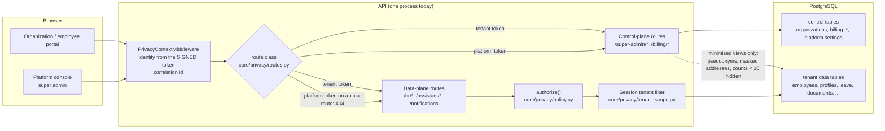

# Trust boundary: control plane and data plane

## The rules
| Boundary | Enforced by | Fails |
|---|---|---|
| Who the caller is | the signed token only (never a URL, query string, body or header); `core/privacy/middleware.py` | closed (unknown token: 401) |
| Platform vs data plane | `core/privacy/routes.py` (unknown paths are DATA_PLANE), the middleware and `core/dependencies.get_current_user` | 404, identical to an unknown URL |
| Tenant vs tenant | route filters, `tenant_scope.py` (every ORM query and write), row-level security (database), composite foreign keys (database) | no rows / refused |
| Field level | `policy.authorize`, `core/privacy/employee_view.py` | masked |
| Mira | `assistant/tool_registry.py`, caller's own rights | refusal text |
| Other Zoiko products | `core/privacy/tokens.py` (audience + scope) | 401 |
| Files | tenant-prefixed paths, 5-minute signed links (`core/privacy/files.py`) | 404 / 410 |

## Identities and database roles
| Identity | Request path | Database role (target, see `db_roles.md`) |
|---|---|---|
| Employee, manager, HR admin, organization admin | tenant plane | `zhr_app_tenant`, bound by row-level security |
| Platform (super admin) | control plane only | `zhr_app_platform`, no grant on tenant data tables |
| Background workers | jobs, `core/privacy/jobs.py` | `zhr_jobs`, tenant set per task |
| BI | approved aggregate views | `zhr_bi_readonly` |
| Migrations | none at runtime | `zhr_migrator` (owner) |

Today the application still connects with a single database role (see `control_status.md`); the table above is where it has to go.
