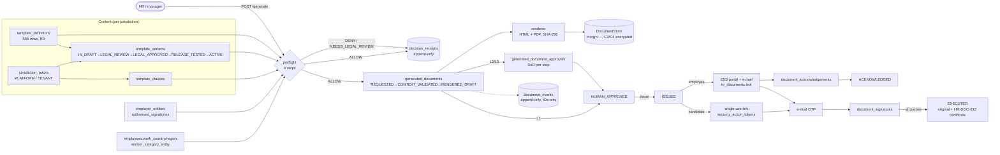

# Document template engine — architecture

Prompt 1 of 4 of the template rollout (ZHR-ELT-TPL-001 v1.0). Code: `backend/app/modules/doc_templates/`.
Frontend: `frontend/src/modules/zoiko-hr/documents/{templates,generated}/`, ESS signing in `modules/zoiko-hr/ess/`, public
pages in `src/pages/public/`.

## Principles

| Rule | Where it is enforced |
|---|---|
| Fail closed: no ACTIVE variant for the resolved jurisdiction → no document | `preflight.run_preflight` (nine steps, every denial has a reason code) |
| Server-side only | `renderer.py` renders HTML and PDF from structured blocks; the browser only displays them in a sandboxed iframe |
| No template code execution | `resolver.py` recognises three placeholder forms with a regex; `conditions.py` is a data grammar; nothing is `eval`ed or Jinja-rendered |
| Separation of duties | `approvals.py` (documents), `content.py` (author ≠ reviewer ≠ releaser for variants, clauses, packs) |
| Generating never changes HR state | `service.py` writes only engine tables (+ an `hr_documents` link row); `test_dt_flow.py` compares the employee row before/after |
| Acknowledgement ≠ signature ≠ consent | separate tables (`document_acknowledgements`, `document_signatures`), separate versioned wording (`governance.ACK_*`, `CONSENT_*`) |
| AI cannot issue | the assistant tool registry has no document resource and does not import the engine (`test_dt_security.py`) |
| Privacy | tenant filter on every engine table that holds people/documents, `authorize()` on every subject and document, platform 404, ID-only events/e-mails, C3/C4 encrypted at rest |

## Flow

## Modules

| File | Responsibility |
|---|---|
| `models.py` | 22 tables; ORM guards: append-only evidence, frozen variant/clause content |
| `registry.py` | catalogue loader (566), family counts, defaults per kind, IMPLEMENTED set, role matrix |
| `fields.py` | field registry (key, label, type, classification, source, synthetic sample) |
| `resolver.py`, `conditions.py`, `blocks.py` | placeholders, `include_when` grammar, block validation, locked blocks, checksums |
| `renderer.py` | layout → HTML (inline styles, escaped) and PDF (ReportLab, Noto fonts, page X of Y, deterministic) |
| `preflight.py` | the normative order of §5.1, decision receipts |
| `approvals.py` | L1/L2/L3 chains, separation-of-duties checks |
| `state.py` | the only writer of `generated_documents.status` (attribute listener refuses any other write) |
| `service.py` | generate, approve, issue, deliver, cancel, correct, legal hold, numbering |
| `signing.py` | candidate links, OTP, signatures, declines, acknowledgements, executed PDF |
| `content.py` | packs, variants, clauses lifecycle; HR-DOC-003/018 records |
| `governance.py` | the ten HR-DOC records (PDF/CSV/JSON) |
| `distribution.py` | HR-DOC-014 policy distribution, bulk generation |
| `entities.py` | legal entities, signatories, worker jurisdiction facts |
| `jobs.py` | reminders, expiry, HR-DOC-016 collection and digest, retention flags, new joiners |
| `storage.py` | `DocumentStore` interface + local implementation |
| `notify.py` | e-mails and integration events (IDs only) |
| `retention.py` | refuses hard deletion of people who appear in document evidence |
| `starters.py`, `seeds/` | versioned starter content (Prompts 2–4) and its loader; `plan_features.json` (plan entitlements) |
| `hooks.py` | document events, context providers and signals that let HR modules react without the engine knowing them |
| `fields_hr.py`, `fields_work.py`, `fields_perf.py` | module fields (recruitment/onboarding, policies/leave/time/pay, performance/changes) |
| `automation.py` | per-organization automation rules (off / draft / auto-issue for L1 NONE/ACKNOWLEDGE only) |
| `entitlements.py` | which billing feature each template needs (configuration) |
| `golive.py` | documents to action, country activation kit and counsel pack, retention queue, reporting, languages, platform emergency controls |

HR integration modules (next to the data they own, in `app/modules/hr/`): `recruitment_documents`, `workforce_documents`,
`onboarding_documents` (Prompt 2); `policy_documents`, `leave_documents`, `time_documents`, `compensation_documents` (Prompt 3);
`performance_documents`, `learning_documents`, `change_documents` (Prompt 4). Mira's boundaries: `assistant/document_intents.py`.

## Preflight (§5.1)

1. **actor** — in the tenant; role allowed for the family (`registry.request_roles`); `authorize()` on the subject (managers: reports only).
2. **definition** — exists, implemented, not an engine record, plan entitlement `hr.documents.templates`.
3. **jurisdiction** — work country/region from the person (candidate: the offer's `work_country`); employer entity complete. Unknown country → `NEEDS_LEGAL_REVIEW`.
4. **pack** — ACTIVE and effective; tenant region → tenant country → platform region → platform country. A region pack never covers another or an unknown region.
5. **variant** — exactly one ACTIVE, effective, applicable variant for template + pack + language. Tenant variants only when tenant attestation is allowed. Cross-border (entity country ≠ work country) only when the variant's `applicability.cross_border_from` names the entity country.
6. **clauses** — every mandatory clause ACTIVE in the pack (tenant → platform → DENY); nothing prohibited.
7. **fields** — every required field resolves; missing ones are listed (`MISSING_FIELD:<key>`).
8. **recipient** — portal account / e-mail, authorised signatory when the employer signs, enough distinct approvers.
9. **evidence** — decision receipt + field snapshot (generate only; `POST /preflight` persists nothing).

## Access

| Who | Templates & content | Generated documents |
|---|---|---|
| admin, hr_admin | read; hr_admin authors; admin approves/releases (never their own) | all in their organization |
| manager | — | documents about their reports in HR-PRF/HR-TIM/HR-LEV, C2 only; requested by them |
| employee | — | their own, after issue, never HR-internal records |
| authorised signatory (any role) | approve variants/clauses if admin | L3 signatory step and employer signature for documents in their scope |
| candidate | — | one document, via a single-use link + OTP |
| super admin | 404 | 404 (support access only through the existing grant flows) |

## Storage, numbering, integrity

* Files: `HR_GENERATED_DOCS_DIR/t<org>/<number>-<sha256[:12]>.pdf|.html` (+`.enc` for C3/C4). Served only through signed links (≤5 min) after authorization; every download is a `document_events` row.
* Numbers: `{ORGCODE}-{YYYY}-{000001}`, counter row locked in the generating transaction (a denied or rolled-back request consumes no number).
* Every signature and acknowledgement re-hashes the stored original and refuses a mismatch (`DOCUMENT_INTEGRITY_FAILED`).
* The executed PDF is a new file (original pages + HR-DOC-012 certificate) with its own hash; the original is never modified. Signature lines on the original stay blank; the signed evidence lives on the certificate page.
* Public verification `GET /public/documents/verify/{number}?h=<16 hex>` needs the file's hash prefix (original or executed) and reveals only validity, issuer, template title, issue date and status.

## Limits of this release

* In-house electronic signature, not a qualified one. `signing.SignatureProvider` is the adapter seam for DocuSign / Adobe Sign / Zoiko Docs Pro.
* PDF fonts cover Latin/Greek/Cyrillic and Devanagari (unshaped). CJK, Arabic, Hebrew and Thai need additional fonts and shaping.
* Bulk generation runs inside the request (≤200 subjects), drafts only, with a persisted run record.
* New joiners receive published policies within 30 minutes (scheduled job), because no employee-created event exists.
